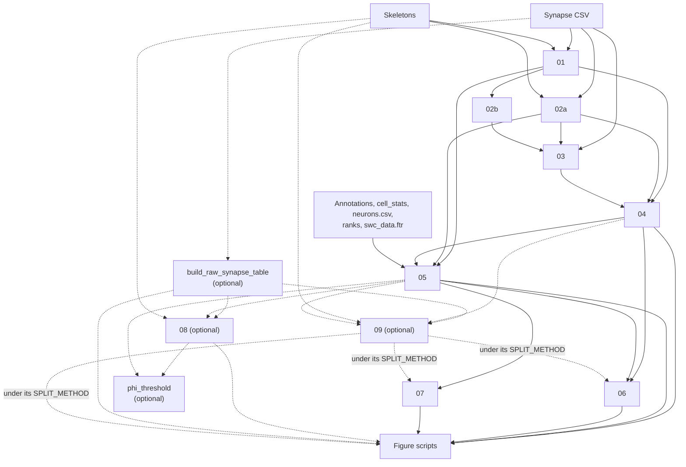

# Organizational principles governing synapse types in a whole-brain connectome

Code for the manuscript *Organizational principles governing synapse types in a whole-brain connectome* by Amit Gross, Majd Farah and Dr David Deutsch.

## About

The analysis uses the FlyWire FAFB v783 connectome of the adult fruit fly brain, with one SWC skeleton per neuron and the Princeton synapse table.

Each neuron's skeleton is split into an axon and a dendrite, sometimes with a short linker between them. We then measure how well the neuron keeps its inputs and outputs apart on those two sides. That is the segregation index (SI), which runs from 0 (mixed) to 1 (fully separated). Each synapse gets a two-letter type, the sending neuron's compartment followed by the receiving neuron's: AD, AA, DD or DA. A synapse with a linker end gets a type such as AL or LD, which the analyses leave out. The rest of the code builds tables from these labels and makes the figures in the paper, which look at synapse types across neuron classes, neurotransmitters, neuron shape, brain regions and reciprocal connections.

The folder [MSB-and-Post-on-MSB-pipeline/](MSB-and-Post-on-MSB-pipeline/) holds two separate pipelines. `MSB_pipeline` groups presynapses into multi-synapse boutons (MSBs) using DBSCAN on distances along the skeleton, and `Post_on_MSB_pipeline`, which runs after it, finds the postsynapses on spines coming off those boutons.

## What you can reproduce

The demo runs without downloading anything, since its 200 neurons, their synapses and skeletons are in `demo/`. The two MSB pipelines also come with their own sample data and READMEs.

The full pipeline cannot be run from public data alone. With the Codex downloads you can run steps 01 to 04, but step 05, which builds the per-neuron table, also needs a file called `swc_data.ftr` that no script here makes. Steps 06 to 08, the Phi-cutoff script, the two synapse-type tools and almost all figure scripts need step 05's table, so from the downloads alone none of them can run.

Sixteen tables that the scripts read are not made anywhere in this repository, and one more input, the neuropil synapse table read by `figures/fig2/si_x_twigs.py`, has to be requested from the corresponding authors. All seventeen are listed in [docs/data_availability.md](docs/data_availability.md), and the scripts that need them will not run without them. Three of the sixteen tables come from the earlier Buhmann synapse detection. The pipeline here is written for the Princeton synapse table; the Buhmann section of docs/data_availability.md says what would have to change and which panels need those tables (among them all of Figure 6's script-made panels). The larval curve in Figure 2A can't be rebuilt either: it needs raw files from the corresponding authors, and the larva script currently gives no usable output (see [docs/pipeline_overview.md](docs/pipeline_overview.md)).

The derived tables in `data/derived/` are not included; they are available from the corresponding authors on request.

## Quick-start demo

The notebook `demo/demo.ipynb` runs the core steps on 200 sample neurons: it splits each neuron, labels each synapse and computes SI.

To run it on Colab, open it here: [](https://colab.research.google.com/github/deutschlab/mixed-polarity-paper/blob/main/demo/demo.ipynb). Note that Colab installs the latest navis rather than the pinned `navis==1.7.0`, so the SI values there can come out slightly different. The demo splits cells with navis's own flow centrality, not `methods/flow_centrality.py` as steps 01, 02a and 08 do; with navis 1.7.0 the two give the same values. The badge opens the notebook as it is on the `main` branch, so changes on other branches are not in it.

To run it locally, set up the environment first (see [Setup](#setup)), install Jupyter (`pip install notebook`, it isn't in the pinned requirements), then run `cd demo && jupyter notebook demo.ipynb`. It took 56 seconds on a laptop. It writes two files: `demo/output/SI_results_demo.csv`, with the SI of every neuron whose split worked (all 200 in our run), and `demo/output/connectors_demo.csv`, which has one row per synapse end on those neurons, with its compartment (A, D or L); a synapse between two demo neurons appears twice.

The demo only covers the SI steps, not the MSB pipelines.

## Setup

| Requirement | |
|---|---|
| Python | 3.12.4 on Linux, macOS or Windows. Other Python versions may not work with the pinned packages |
| Packages | Pinned in `requirements.txt` and `environment.yml`, including `navis==1.7.0`, `pandas==2.2.2`, `numpy==1.26.4`, `scikit-learn==1.5.2`, `scipy==1.13.1`, `matplotlib==3.9.2` and `seaborn==0.13.2`. Keep navis at 1.7.0 (other versions can give different SI values), without navis-fastcore |
| Memory | 32 GB recommended for the full pipeline (use goes above 16 GB). The optional `processing/build_raw_synapse_table.py` peaked at about 40 GB (22 GB resident) on a 36 GB Mac. No special hardware is needed |
| Disk | Raw inputs about 43 GB; the raw synapse tables in `data/derived/` (made by `build_raw_synapse_table.py`) about 7 GB; one full run's tables, SFC and MaxSI together, under 40 GB more |
| Install time | About 5 to 10 minutes with conda, or 10 to 20 with pip |

```bash
# conda (recommended)
conda env create -f environment.yml
conda activate fafb783-synapse-polarity

# or pip, in a new virtual environment
python3.12 -m venv .venv
source .venv/bin/activate          # on Windows: .venv\Scripts\activate
pip install -r requirements.txt
```

On macOS with pip, `xgboost` also needs `brew install libomp`. Conda takes care of this.

**Memory and time per step**, from one full run on a Mac with 36 GB of memory and 14 cores (resident memory is the most the step held in RAM; steps 01 and 09 ran as 5 copies at once):

| Step | Resident memory | Time |
|---|---|---|
| 01 | 6.2 to 6.7 GB per copy; at least 17.7 GB for the 5 together (sampled once a minute), at most 32.3 GB (the sum of the copies' peaks) | about 2 hours (each copy 1.8 to 1.9 hours) |
| 02a | 12.9 GB | 27 minutes |
| 02b | 3.4 GB | 58 seconds |
| 03 | 14.0 GB | 86 seconds |
| 04 | 17.7 GB | 41 seconds |
| 05 | 14.7 GB | 56 seconds |
| 06 | 20.6 GB on the SFC tables, 18.5 GB on the MaxSI ones | 28 to 29 seconds on each |
| 07 | 0.5 GB | 2 seconds on each split |
| 09 | 5.5 to 6.3 GB per labelling copy; at least 14.7 GB for the 5 together (sampled once a minute), at most 29.6 GB (the sum of the copies' peaks); 22.2 GB to build its tables | about 30 minutes to label the cells (each copy 28 to 29 minutes); 67.5 seconds to build the tables from the saved batches |

Step 08 and `build_raw_synapse_table.py` are not in the table: `build_raw_synapse_table.py` is in the Memory row above. Step 08 has not been timed on the full set; a check of it on 1,144 neurons, with navis's own flow centrality, is under [Checking the split methods](docs/tools.md#checking-the-split-methods).

**Planning a machine** (details in [docs/pipeline_overview.md](docs/pipeline_overview.md#running-on-your-own-machine)):

- Measured on one machine only: an Apple M4 Max Mac, 36 GB, 14 cores, macOS. Not tried on Linux or Windows, nor on any machine under 36 GB.
- Step 09's table building (30.3 GB peak footprint), step 06 (20.6 GB resident), step 03 (19.1 GB footprint) and step 04 (17.7 GB resident) each run as one process, so they set a memory floor. Plan on 32 GB plus swap; on Linux or Windows, set up swap.
- Steps 01 and 09 run as several copies; only 5 copies have been measured, and step 01 as 5 copies held more than 16 GB. On a smaller machine run them as fewer copies, but each copy then holds more memory. Run no more copies than cores.
- With 5 copies, the running times of steps 01 to 07 and 09 add up to about 3 hours. The copies used 9.3 CPU-hours for step 01 and 2.3 for step 09; one copy has not been timed. Steps 01, 08 and 09 resume if stopped; the others start again.
- On another machine, expect the same values but not the same bytes (file listing order and the processor's last digits differ): sort by `synapse_id` or `root_id` and compare with a small tolerance.

### Data

Most of the data is not in this repository. Three inputs are included in `data/raw/`: the neuron annotation table (`Supplemental_file1_neuron_annotations.csv`) and the 15 sensory-rank files in `data/raw/ranks/`, both from Dorkenwald et al. 2024, and the list of cell types left out of the Fig 7 bouton analysis (`msb_excluded_cell_types.csv`). Step 05 matches each rank file to the neurons by its own `root_id`. In the published neuron table (`data/derived/`), only `allinputs_layer_mean` is matched by neuron ID; the other `*_layer_mean` columns hold other neurons' values, and no figure script reads them. The connectome files come from the [FlyWire Codex download page](https://codex.flywire.ai/api/download?dataset=fafb). [data/README.md](data/README.md) and [docs/data_availability.md](docs/data_availability.md) list every file, where to get it and where to put it.

Skeletons go in subfolders of `data/raw/swc/783/`, one file per neuron named `<root_id>.swc`. Any number of subfolders is fine (we used batches of about 1,500 neurons), but files placed directly in `data/raw/swc/783/` won't be found. (The demo keeps its skeletons in one flat folder, `demo/swc/`, because the notebook loads them itself.) If the archive unpacks into one flat folder, make a subfolder and move the files into it. Step 01 gives no error when it finds no skeletons; it just writes nothing.

### Paths

All paths are set in `config.py`, and `ROOT` finds the repository folder on its own. You only need to edit `config.py` if you keep a file in a different place or under a different name.

## Reproducing the analysis



Each step below links to its full description in [docs/pipeline_overview.md](docs/pipeline_overview.md#pipeline-flow), which also has the full chart of inputs.

| Step | What it makes | Needs | Time (one full run, 36 GB Mac) |
|---|---|---|---|
| [01](docs/pipeline_overview.md#script-01--extract-compartments--si-standard-neurons) | Compartment labels and SI per neuron | Synapse CSV, skeletons | About 2 hours as 5 copies |
| [02a](docs/pipeline_overview.md#script-02a--large-neurons-pipeline) | The same for the very large neurons | Synapse CSV, skeletons | 27 minutes |
| [02b](docs/pipeline_overview.md#script-02b--merge-connectors) | Step 01's synapse labels collected into two tables | 01, finished on every subfolder | 58 seconds |
| [03](docs/pipeline_overview.md#script-03--merge-synapses-and-connectors) | The labels added back to the synapse list | Synapse CSV, 02a, 02b | 86 seconds |
| [04](docs/pipeline_overview.md#script-04--build-master-synapse-table) | `data/derived/synapses_783_article_princeton.ftr` | 01, 02a, 03 | 41 seconds |
| [05](docs/pipeline_overview.md#script-05--build-neuron-metadata-table) | `data/derived/neuron_data_full_article_princeton.ftr`, `SI_updated.ftr` | 01, 02a, 04, annotations, `cell_stats.csv`, `neurons.csv`, ranks, `swc_data.ftr` | 56 seconds |
| [06](docs/pipeline_overview.md#script-06--build-connection-and-reciprocity-table) | The per-connection and reciprocity tables | 04, 05 | 28 to 29 seconds |
| [07](docs/pipeline_overview.md#script-07--pca-of-morphological-features) | `data/derived/neurons_pca_princeton.ftr` | 05 | 2 seconds |
| [build_raw_synapse_table.py](docs/pipeline_overview.md#raw-synapse-table-optional) (optional) | The raw synapse table (two versions) | Synapse CSV | 2 minutes |
| [08](docs/pipeline_overview.md#script-08--alternative-split-methods-optional) (optional) | `data/derived/SI_comparisons.ftr` | 05, raw synapse table, intrinsic neurons' skeletons | |
| [phi_threshold.py](docs/pipeline_overview.md#phi-threshold-optional) (optional) | The Phi cutoff that matches SI = 0.1 (printed, and a plot) | 05, 08 | |
| [09](docs/pipeline_overview.md#script-09--maxsi-minfisherp-and-maxphi-synapse-labels-optional) (optional) | Synapse, neuron and SI tables in `data/derived_maxsi/` (or `_minfisherp`, `_maxphi`) | 04, 05, raw synapse table without self-synapses, all skeletons | About 30 minutes as 5 copies (MaxSI) |
| [larva/larva_process.py](docs/pipeline_overview.md#larval-step-for-figure-2a) | Larval SI for Figure 2A, run separately | Larval raw files | |
| [larva/larva_maxsi_labels.py](docs/pipeline_overview.md#larval-maxsi-step-for-figure-2a-on-the-maxsi-split) | Larval SI and synapse tables on the MaxSI split, in `data/larva_maxsi/` (Figure 2A under `SPLIT_METHOD = "maxsi"`) | Larval raw files | About 2 minutes |
| [larva/larva_pc1.py](docs/pipeline_overview.md#larval-pc1-step) | Each larval cell's PC1, in `data/larva_maxsi/` | larva_maxsi_labels.py | About 15 seconds |

| Setting | Where | What it does |
|---|---|---|
| `PIPELINE_RUN` | `config.py` | `"published"` (default): the delivered tables; steps 01 to 07 stop at the start (`refuse_published_run`). `"rebuild"`: a fresh run into `data/derived_rebuild/`, `data/intermediate_rebuild/`, `outputs_rebuild/` |
| `SPLIT_METHOD` | `config.py` | The split the scripts read: `"sfc"` (the published split, the default), `"maxsi"`, `"minfisherp"` or `"maxphi"`. Leave it at `"sfc"` until step 09 has written that method's three tables |
| `METHOD`, or `STEP09_METHOD` | step 09 | Step 09's cut: `"maxsi"` (default, highest SI), `"minfisherp"` (lowest two-sided Fisher exact p) or `"maxphi"` (highest \|phi\|), each into its own folders |
| `RAW_TABLE_KEEP_SELF_SYNAPSES` | `config.py` | Raw synapse table without (`False`, default) or with self-synapses. Step 09 needs `False` |
| `ACCEPT_FAILED_CELLS`, or `STEP09_ACCEPT_FAILED_CELLS`; `ACCEPT_CELLS_WITHOUT_SKELETON` | step 09 | Step 09 writes no table if a cell has no usable skeleton (unless `ACCEPT_CELLS_WITHOUT_SKELETON = True`) or the number of failed cells is not `ACCEPT_FAILED_CELLS` (default: none may fail). Run it once, read the count and errors it prints, then set these two, for each method |
| `N_SHARDS`, `SHARD` (or `STEP01_N_SHARDS`/`STEP01_SHARD`, `STEP09_N_SHARDS`/`STEP09_SHARD`) | steps 01 and 09 | Run the step as several copies at once, one per `SHARD`, all with the same `N_SHARDS`. Step 09 then needs a last run with `N_SHARDS = 1` to build its tables; see [step 01](docs/pipeline_overview.md#script-01--extract-compartments--si-standard-neurons) and [step 09](docs/pipeline_overview.md#script-09--maxsi-minfisherp-and-maxphi-synapse-labels-optional) |

What each setting moves and stops is in [docs/pipeline_overview.md](docs/pipeline_overview.md#settings-split_method-and-pipeline_run).

Before a fresh run, set `PIPELINE_RUN = "rebuild"` in `config.py` (under the default `"published"`, steps 01 to 07 stop at the start), and make sure `data/derived/swc_data.ftr` exists (and, for steps 08 and 09, the raw synapse table; see the notes below). Then run the steps in this order, from the repository root:

```bash
python processing/01_extract_compartments_SI.py        # takes hours; compartment labels and SI per neuron
python processing/02a_large_neurons_pipeline.py        # the very large neurons, in a separate pass
python processing/02b_merge_connectors.py
python processing/03_merge_synapses_connectors.py
python processing/04_build_master_synapse_table.py     # -> data/derived/synapses_783_article_princeton.ftr
python processing/05_build_neuron_metadata_table.py    # -> data/derived/neuron_data_full_article_princeton.ftr (needs swc_data.ftr)
python processing/06_build_connection_reciprocity_table.py
python processing/07_pca_morphology.py                 # -> data/derived/neurons_pca_princeton.ftr
python processing/build_raw_synapse_table.py           # optional, before 08 -> the raw synapse table (two versions)
python processing/08_alternative_split_methods.py      # optional -> data/derived/SI_comparisons.ftr
python processing/phi_threshold.py                     # optional, after 05 and 08
python processing/09_maxsi_synapse_labels.py           # optional -> data/derived_maxsi/ (MaxSI synapse, neuron and SI tables)
STEP09_METHOD=minfisherp python processing/09_maxsi_synapse_labels.py   # optional -> data/derived_minfisherp/
STEP09_METHOD=maxphi python processing/09_maxsi_synapse_labels.py   # optional -> data/derived_maxphi/
python processing/buhmann_maxsi_labels.py               # optional, "rebuild" + "maxsi" -> data/derived_rebuild_maxsi/; needs the published Buhmann tables, not deposited
python processing/bouton_maxsi_tables.py                # optional, "rebuild" + "maxsi" -> data/derived_rebuild_maxsi/ (the two Fig 7 bouton tables); needs the authors' bouton tables, not deposited
```

Notes:

- Step 05 reads `swc_data.ftr`, which no script here writes. The code that writes it is inside step 05 (lines 137-190), in a commented-out block that points to a local Windows path.
- Step 01 skips neurons with more than 80,000 skeleton nodes; step 02a processes the large neurons, from a list of 186 neuron IDs written into the script, not from step 01's size check (182 of them got an SI). Run step 02b only after step 01 has finished every subfolder.
- `swc_data.ftr`, `neuron_data.ftr` and the raw synapse table stay in `data/derived/` under `"rebuild"` too, since no step from 01 to 07 makes them. The raw table is needed only by steps 08 and 09, the optional `processing/buhmann_maxsi_labels.py` and `processing/bouton_maxsi_tables.py` (which reads the version without self-synapses, `SYNAPSE_TABLE_RAW_NO_SELF_FTR`, directly, not through the `RAW_TABLE_KEEP_SELF_SYNAPSES` switch), and six figure scripts (`figures/fig1/create_split_axon_dendrite_princeton.py`, `figures/fig1/fig1c_example_splits.py`, `figures/fig3/fig3c_ma_mm_examples.py`, the two `figures/split_methods/skeleton_comparisons*.py` and `figures/split_methods/method_examples.py`). For a split made by step 09, run 01 → … → 05, then 09 with that method, then set `SPLIT_METHOD` to the same method and run 06 → 07, then the figure scripts, the ones that write tables first.
- Tables with no MaxSI version (`MAXSI_NOT_AVAILABLE`) stop the scripts that read them under `"maxsi"`, and the same holds for the other two methods. Do not copy the SFC files into the `_maxsi` folders to make them run. If a script stops on a missing file in a `_maxsi` folder, either the script that writes it (09, 06, 07 or a figure script) has not yet run under `"maxsi"`, or the table has no MaxSI version.
- The larval SI for Figure 2A comes from `processing/larva/larva_process.py` (SFC split), which runs separately from these steps; as committed it gives no usable output (see above). Under `SPLIT_METHOD = "maxsi"` Figure 2A reads the larval MaxSI tables from `processing/larva/larva_maxsi_labels.py` instead, which also runs separately. Each larval step writes its own folders, whatever `PIPELINE_RUN` is.

### Figures

The figure scripts are in `figures/fig1/` to `figures/fig7/`, usually one per panel, plus `figures/split_methods/` (the split-method comparison) and `figures/supporting/` (numbers in the text). They are `#%%` cell scripts for an editor like Spyder, but also run as plain Python from any folder; each plot then opens in a window and waits to be closed, which `tools/run_figure.py` avoids.

`figures/fig1/create_split_axon_dendrite_princeton.py` and `figures/fig3/fig3c_mixed_example_sfc.py` make a Neuroglancer link through `caveclient` before they draw, so they stop with an error unless you have a FlyWire account and a CAVE token saved on your machine. Every script imports `caveclient` and `nglui` through `methods/methods_all.py`, so both must be installed (they are in the pinned requirements).

Six scripts need others to run first: `figures/fig4/build_pc1_table.py` before `figures/fig4/syntype_x_pc1.py`, `figures/fig4/fig4_heldout_models.py` before `figures/fig4/models_comparison.py`, `figures/fig5/reciprocal_fraction.py` before `figures/fig5/reciprocal_fraction_model.py`, the three `figures/fig7/si_sim_*.py` scripts before `figures/fig7/si_comb_analysis.py`, and `figures/fig7/fig7i_filopodia_fraction_x_nt.py` before `figures/fig7/filopodia_x_mirror_neurons.py` and `figures/fig5/reciprocal_fraction_x_bwf.py` (it writes `neurons_nt_bwf_frac.ftr`; if it stops with an error, or is left out of a run such as `--only fig5`, those two read whatever copy is already there).

Every text a script saves is Arial 8 pt: each script calls `use_arial_8()` from `methods/figure_text.py`, which sets all text (axes, ticks, legends, titles, colour bars, annotations, table cells) to Arial 8 pt as the figure is saved, and builds every legend at 8 pt, whatever sizes the script set. `tools/check_figure_text.py --outputs` reads a run's saved files and lists any text that is not. It changes only text, but labels take a different amount of room at 8 pt, so a panel's layout can shift.

Each script saves its figures as SVG in its own folder, usually `outputs/figN/<name>/` (`outputs_maxsi/` under `SPLIT_METHOD = "maxsi"`); a few also write tables into `data/derived/` (`data/derived_maxsi/` or `data/intermediate_maxsi/` under `"maxsi"`). [docs/figure_to_script_map.md](docs/figure_to_script_map.md) shows which script makes which panel and where it saves it, with the exceptions and the token details in its section [Running the figure scripts](docs/figure_to_script_map.md#running-the-figure-scripts).

A note on SI: most figure scripts take SI from the neuron or synapse table, and eleven always take it from `SI_updated.ftr` (six in `figures/fig2`–`fig3`, `figures/fig7/filopodia_x_mirror_neurons.py` and four in `figures/split_methods/`: the two MaxSI scripts, `four_methods_si_comparison.py`, which reads each split's, and `method_examples.py`, which checks its SFC split against it). The neuron and synapse tables the figures were made from come from an earlier run whose SI kept synapses from a neuron to itself, except for the 182 large cells from step 02a; the manuscript's Methods exclude self-synapses, as `SI_updated.ftr` does. After a fresh run each neuron has the same SI in the synapse table, the neuron table and `SI_updated.ftr`; tables from an earlier run may not match, which is why the synapse-type tools call the table SI "older" and `SI_updated.ftr` "corrected". (`SI_updated.ftr` has a few more neurons than the neuron table.) More in the same section of the map.

## Tools

Run these from the repository root with the environment active. [docs/tools.md](docs/tools.md) has each tool's full description, options and example commands.

| Tool | What it checks or does | Needs | Time, output |
|---|---|---|---|
| [`run_figure.py`](docs/tools.md#checking-that-a-figure-reproduces) | Runs a figure script with fixed, comparable output | The script's inputs | `outputs/tools/run_figure/<script name>/` |
| [`compare_outputs.py`](docs/tools.md#checking-that-a-figure-reproduces) | Compares the output folders of two runs | Two `run_figure.py` runs | Printed |
| [`run_all_figures.py`](docs/tools.md#checking-that-a-figure-reproduces) | Runs every figure script, one after another | Every script's inputs | Several hours; `--out`. Scripts that write tables still replace them in their usual place |
| [`compare_runs.py`](docs/tools.md#checking-that-a-figure-reproduces) | Compares two full runs script by script | Two `run_all_figures.py` runs | Printed, or `--report FILE` |
| [`compare_split_figures.py`](docs/tools.md#checking-that-a-figure-reproduces) | The numbers each figure draws in two full runs on different splits, panel by panel | Two `run_all_figures.py` runs | Under a second; `outputs/tools/compare_split_figures/` |
| [`check_raw_synapse_table.py`](docs/tools.md#checking-the-data-tables) | The two raw synapse tables after building them | Step 04's table, about 10 GB of memory | One to two minutes |
| [`check_step05_root_id.py`](docs/tools.md#checking-the-data-tables) | That step 05 writes `root_id` as exact cell IDs | Step 05's outputs, about 5 GB of memory | A few seconds |
| [`check_fig6_logic.py`](docs/tools.md#checking-scripts-on-made-up-data) | The Figure 6 script's calculations on a made-up connectome | No data | A few seconds |
| [`check_fig4e_logic.py`](docs/tools.md#checking-scripts-on-made-up-data) | The revised Figure 4E script's calculations on a made-up table | No data | A few seconds |
| [`check_figure_text.py`](docs/tools.md#checking-the-figure-text) | That `methods/figure_text.py` saves every text as Arial 8 pt and changes nothing else; with `--outputs`, the fonts in a run's saved files | No data, or a run's output folder | A few seconds, a few minutes with `--mutants`; `outputs/tools/check_figure_text/` |
| [`make_fig7_ports.py`](docs/tools.md#figure-7-ports) | Makes, or checks, the seven Fig 7 panel scripts from the authors' originals | The originals (maintainers) | Printed |
| [`check_fig7_ports.py`](docs/tools.md#figure-7-ports) | That each Fig 7 panel script draws what the original draws | The originals (maintainers) | About a minute, 5 with `--mutants` |
| [`check_fig7_tables.py`](docs/tools.md#figure-7-ports) | The Fig 7 input tables against a recorded reference | The undeposited tables (maintainers) | About a minute |
| [`check_msb_exclusion.py`](docs/tools.md#figure-7-ports) | The Fig 7 cell-type exclusion list against the two bouton tables | The bouton tables, `neuron_data.ftr` and the Codex cell-type file; the unfiltered bouton tables for the full check (maintainers) | A few seconds; `outputs/tools/check_msb_exclusion/` |
| [`synapse_type_shares.py`](docs/tools.md#synapse-type-tools) | Share of each synapse type in a synapse table | Step 05's tables, about 4 GB | Printed |
| [`split_agreement.py`](docs/tools.md#synapse-type-tools) | Agreement of synapse types between splits | About 12 GB, and a table with two synapse-type columns (none here has more than one) | Printed |
| [`check_split_methods_on_subset.py`](docs/tools.md#checking-the-split-methods) | Runs step 08 on some neurons and compares with a reference table | Raw synapse table, local skeletons | 28 to 36 minutes for 1,144 neurons (macOS, with navis's own flow centrality); `--out` |
| [`check_split_functions.py`](docs/tools.md#checking-step-08s-split-code) | Step 08's split code on made-up neurons, against a separate reference | No data | About 40 seconds |
| [`check_step09_failures.py`](docs/tools.md#checking-step-08s-split-code) | Step 09 on five local cells with planted failures, and its three tables | SFC and raw tables, five skeletons | About four minutes |
| [`compare_split_runs.py`](docs/tools.md#comparing-two-runs-of-step-08) | The cuts of two step 08 runs on the same neurons | Two step 08 runs | `outputs/tools/compare_split_runs/` |
| [`check_simple_pc1_model.py`](docs/tools.md#checking-the-simple-pc1-model) | Rebuilds the Fig 4 simple PC1 model and checks a run of its script | Steps 05 and 07, about 7 GB | About 8 minutes with `--variants` (measured once, macOS) |

All tools are in `tools/`. Most check tools print PASS or FAIL. What a PASS covers differs by tool and is given for most of them in [docs/tools.md](docs/tools.md); none of them shows that an analysis is the right one.

## Main generated tables

The pipeline writes these to `data/derived/`. Step 09 writes MaxSI versions of the first three to `data/derived_maxsi/` (MinFisherP and MaxPhi versions to `data/derived_minfisherp/` and `data/derived_maxphi/`), and with `SPLIT_METHOD = "maxsi"` steps 06 and 07 write their tables there too (likewise for the other two).

| File | Contents |
|------|----------|
| `synapses_783_article_princeton.ftr` | One row per synapse between two different neurons that were both split, with both ends attached to a skeleton: the synapse ID, the two neurons, positions, brain region (`npil`), synapse type (`comp`) and `SI_pre`/`SI_post`. `comp` can take nine values, because a linker end gives types like AL or LD, so filter to AA/AD/DA/DD. |
| `neuron_data_full_article_princeton.ftr` | One row per neuron that could be split and is in both the annotation file and the synapse table: type, SI, shape measurements and connection counts. `neuron` and `root_id` hold the same ID; `nt_type` is the `neurons.csv` prediction and `nt_type_new` the annotation file's `top_nt`; do not use `linker` (step 05 fills it by row position). |
| `SI_updated.ftr` | The SI of every neuron that got one (`root_id`, `SI`) |
| `connections_by_syn_type_reciprocal_types_filtered_article_princeton.ftr` | One row per (`pre`, `post`) pair with at least one AA, AD, DA or DD synapse: synapse counts per type, `sum_syn`, each side's `primary_type`, and `reciprocal` and `same_type` as 0/1 integers |
| `neurons_pca_princeton.ftr` | PC1 and PC2 of each neuron in the four analysed super-classes (`central`, `optic`, `visual_projection`, `visual_centrifugal`) with none of the eight PCA inputs missing (cable length, area, size, leaf count, input and output synapse counts, input and output partner counts); the sign of PC1 is arbitrary |

The full list, with columns, is in [docs/generated_tables.md](docs/generated_tables.md).

## Documentation

- [docs/data_availability.md](docs/data_availability.md): every input file, where it comes from and where it goes
- [docs/pipeline_overview.md](docs/pipeline_overview.md): each processing step, with inputs and outputs, machine requirements and the settings
- [docs/figure_to_script_map.md](docs/figure_to_script_map.md): which script makes which figure panel, and from which tables
- [docs/generated_tables.md](docs/generated_tables.md): every derived table, which script writes it and its columns
- [docs/tools.md](docs/tools.md): the check and comparison tools, with their options and commands
- [data/README.md](data/README.md): the data folder and where each file goes

## Repository layout

```
README.md           this file
CITATION.cff        how to cite the code
LICENSE             MIT
config.py           all file paths
requirements.txt    pinned packages (pip)
environment.yml     the same packages for conda

processing/         the pipeline, from raw data to derived tables
  01_extract_compartments_SI.py            split each neuron, label synapses, compute SI
  02a_large_neurons_pipeline.py            the same for very large neurons
  02b_merge_connectors.py                  collect step 01's synapse labels into two tables
  03_merge_synapses_connectors.py          add the labels back to the synapse list
  04_build_master_synapse_table.py         the per-synapse table
  05_build_neuron_metadata_table.py        the per-neuron table
  06_build_connection_reciprocity_table.py the per-connection and reciprocity tables
  07_pca_morphology.py                     PCA of the shape measurements
  build_raw_synapse_table.py               optional: the raw synapse table from the Codex CSV (for 08 and the split-method figures)
  08_alternative_split_methods.py          optional: two single-node cuts compared with the published split
  09_maxsi_synapse_labels.py               optional: synapse, neuron and SI tables under the MaxSI, MinFisherP or MaxPhi split
  buhmann_maxsi_labels.py                  optional: the Buhmann synapse and neuron tables on step 09's MaxSI cuts
  bouton_maxsi_tables.py                   optional: the two Fig 7 bouton tables on the MaxSI synapse table
  phi_threshold.py                         optional: the Phi cutoff that matches SI = 0.1
  larva/larva_process.py                   larval SI for Figure 2A
  larva/larva_maxsi_labels.py              larval SI and synapse tables on the MaxSI split
  larva/larva_pc1.py                       each larval cell's PC1

methods/
  methods_all.py    shared functions, used by most scripts
  node_cut_si.py    the SI of every single-node cut, used by steps 08 and 09
  flow_centrality.py  navis's synapse flow centrality without its dense matrix, used by steps 01, 02a and 08
  figure_text.py    every saved text in Arial 8 pt, used by every figure script and phi_threshold.py

figures/            69 scripts: fig1/ 7, fig2/ 11, fig3/ 14, fig4/ 8, fig5/ 8, fig6/ 1, fig7/ 13, split_methods/ 6, supporting/ 1

tools/              check and comparison tools (see Tools above and docs/tools.md)

demo/               the demo notebook and its 200-neuron data set

data/               mostly empty; the data goes here (see data/README.md)
  raw/              downloaded inputs, plus the included annotation table, ranks/ and the Fig 7 exclusion list
  derived/          tables made by the pipeline
  intermediate/     working files made by the pipeline
  derived_maxsi/    tables made on the MaxSI split (step 09, and SPLIT_METHOD = "maxsi")
  intermediate_maxsi/  working files made on the MaxSI split
  derived_minfisherp/, derived_maxphi/, and their intermediate_ folders: the same for the other two splits
  derived_rebuild/  tables made by a fresh run (PIPELINE_RUN = "rebuild")
  intermediate_rebuild/  working files made by a fresh run
  larva/            larval data, from the corresponding authors
  larva_maxsi/      larval tables on the MaxSI split

docs/               the reference documents listed above
  data_availability.md, pipeline_overview.md, figure_to_script_map.md, generated_tables.md, tools.md
outputs/            figures made by the scripts (not included)
outputs_maxsi/      figures made with SPLIT_METHOD = "maxsi" (not included; outputs_minfisherp/, outputs_maxphi/ likewise)
outputs_rebuild/    figures made with PIPELINE_RUN = "rebuild" (not included)

MSB-and-Post-on-MSB-pipeline/   the two MSB pipelines, each with its own README and sample data
```

## Citation

Please cite the manuscript. [CITATION.cff](CITATION.cff) has the citation for this code (DOI 10.64898/2026.06.23.733969).

## License

MIT, see [LICENSE](LICENSE). The two MSB pipelines have their own LICENSE files.
