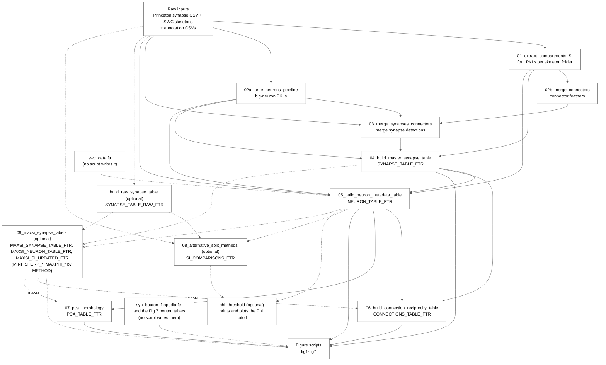

# Pipeline Overview

The processing steps that turn the raw connectome inputs into the derived tables the figure scripts read.

- **Run order:** 01 → 02a → 02b → 03 → 04 → 05 → 06 → 07. Optional: `build_raw_synapse_table.py` (the raw synapse table, from the Codex CSV) → 08 (split-method comparison) → `phi_threshold.py`; and 09 (MaxSI, MinFisherP or MaxPhi labels), after 05 and `build_raw_synapse_table.py`. The larval steps run separately: `processing/larva/larva_process.py` (SFC split, Figure 2A) and `processing/larva/larva_maxsi_labels.py` (MaxSI split, which 2A reads under `SPLIT_METHOD = "maxsi"`), then `processing/larva/larva_pc1.py` (each larval cell's PC1, for the larval 4D). Each writes its own folders, whatever `PIPELINE_RUN` is.
- **Paths:** all in `config.py`; `PIPELINE_RUN` and `SPLIT_METHOD` choose the folders ([Settings](#settings-split_method-and-pipeline_run)).
- **Shared code:** the numbered scripts import `methods/methods_all.py` via `METHODS_DIR`; 08 and 09 also `methods/node_cut_si.py`; 01, 02a and 08 also `methods/flow_centrality.py`, which gives navis's synapse flow centrality without the dense geodesic matrix navis builds when navis-fastcore is not installed (the same values, in a fraction of the memory).

---

## Pipeline flow

---

## Running the pipeline

The README gives the run commands, the settings and each step's memory and time. The steps are split mostly to save memory: the synapse table and all the skeletons don't fit in memory together.

### Running on your own machine

The full pipeline has been run on one machine, a Mac with 36 GB of memory and 14 cores (Apple M4 Max; macOS, Python 3.12.4, the pinned packages); not on Linux or Windows. Each step's memory and time are in the README's [Setup](../README.md#setup) table.

- Memory: plan on 32 GB of memory plus swap (on Linux or Windows, set up swap). Resident memory leaves out pages macOS compresses or swaps, and the peak memory footprint counts them, so it can be higher. Four steps always run as one process, so they set a floor: step 09's table building (30.3 GB footprint), step 06 (20.6 GB resident), step 03 (19.1 GB footprint) and step 04 (17.7 GB resident). No machine smaller than 36 GB has been tried.
- Copies: steps 01 and 09 can run as several copies at once (see Script 01 and Script 09 below). Only 5 copies have been measured, per copy: step 01 6.2 to 6.7 GB resident and 7.9 to 8.3 GB footprint, step 09 labelling 6.6 to 7.1 GB footprint. The 5 step 01 copies together held at least 17.7 GB (sampled once a minute). Fewer copies suit a smaller machine, but each copy then reads a larger share of the synapses and holds more memory. Run no more copies than cores.
- Time: the README's times are for 5 copies, which together used 9.3 CPU-hours for step 01 and 2.3 for step 09. A single-copy run has not been timed. With 5 copies, the running times of steps 01 to 07 and 09 add up to about 3 hours. If stopped, steps 01, 08 and 09 pick up where they left off; the others start again.
- navis: it has to be 1.7.0, without navis-fastcore (install from `requirements.txt` or `environment.yml`): anything else computes the flow centrality differently, which could move the split, so steps 01, 02a and 08 then stop with an ImportError when they import `methods/flow_centrality.py` (02a and 08 straight away, 01 after reading the synapse CSV). That module splits an 80,071-node cell in about 1.0 GB for the whole process, against 9.1 GB with navis's own calculation. Steps 01 and 02a read through the whole synapse CSV first.
- Other machines: the tables should hold the same values, though not always the same bytes. 02a (its per-cell files), 04 and 05 (the per-folder pickles) read files in the order the file system lists them, so rows can come out in a different order, and a different processor can change the last digits of some floating-point values. Compare tables sorted by `synapse_id` (synapse tables) or `root_id` (neuron tables), floating-point columns with a small tolerance, not by checksums.

### Settings: SPLIT_METHOD and PIPELINE_RUN

**`SPLIT_METHOD`** in `config.py` chooses the split the scripts read: `"sfc"` (the published split, the default), `"maxsi"`, `"minfisherp"` or `"maxphi"`. Leave it at `"sfc"` until step 09 has written that method's three tables. Under `"maxsi"` (the others alike, in their own folders: `data/derived_minfisherp/`, `outputs_minfisherp/`, and so on):

- `SYNAPSE_TABLE_FTR`, `NEURON_TABLE_FTR` and `SI_UPDATED_FTR` point to step 09's tables.
- Tables built from them by steps 06, 07 and the table-writing figure scripts (`MAXSI_SWITCHED`) live in `data/derived_maxsi/` and `data/intermediate_maxsi/`, under the same file names; figures and tool reports go to `outputs_maxsi/`. Nothing built on the MaxSI split reaches the published folders.
- Steps 01 to 05 always write the SFC tables, and step 08 and `phi_threshold.py` always read them (step 08 never overwrites an existing `SI_comparisons.ftr`).
- Tables with no MaxSI version (`MAXSI_NOT_AVAILABLE`: the Fig 7 filopodia, inertia and `t2.ftr` tables, the revised Fig 4E's per-type table and the Buhmann connection table) point into `_maxsi` folders that nothing writes, so a script that reads one stops rather than draw an SFC panel among the MaxSI ones; do not copy the SFC files there. A missing file in a `_maxsi` folder means its writer (09, 06, 07 or a figure script) has not yet run under `"maxsi"`, or the table has no MaxSI version. Majd's two per-synapse flag tables (`SYN_BOUTON_FTR`, `SYN_BOUTON_NEW_FTR`) stay in `data/raw/` under every split and run: a flag comes from the skeleton, not the split. They cover the published synapse table's synapses only, and Fig 7H and the three `si_sim_*.py` scripts of 7J leave out any synapse without a flag.
- `processing/buhmann_maxsi_labels.py` (optional, after step 09, under `PIPELINE_RUN = "rebuild"` and `SPLIT_METHOD = "maxsi"`) puts the published Buhmann synapses on the MaxSI cuts step 09 chose from the Princeton synapses (same cut node and axon side; every 20th cell is checked against step 09's Princeton side counts) and writes the two Buhmann tables to `data/derived_rebuild_maxsi/` under their published names. It needs the published Buhmann tables in `data/derived/`, which are not deposited (`docs/data_availability.md`), for the panels that compare the two synapse detectors (Supp 2-S1 B-C, 3-S2 A-C).
- `processing/bouton_maxsi_tables.py` (optional, after step 09, under `PIPELINE_RUN = "rebuild"` and `SPLIT_METHOD = "maxsi"`) builds the two Fig 7 bouton tables (`BOUTON_TABLE_FTR`, `BOUTON_FILOPODIA_TABLE_FTR`) from the authors' per-synapse bouton and filopodia tables (`CLUSTER_INFO_FILTERED_FTR`, `FILOPODIA_FILTERED_PUBLISHED_FTR`) and the MaxSI synapse table, and writes them to `data/derived_rebuild_maxsi/` under their published names. It reads these inputs from `data/derived/`, and they are not deposited (`docs/data_availability.md`). Under `"minfisherp"` and `"maxphi"` it stops, so the bouton panels stop there. Everything it prints goes to `BOUTON_MAXSI_LOG_TXT` too (`outputs_rebuild_maxsi/tools/bouton_maxsi_tables/bouton_maxsi_tables_log.txt`, appended run after run). On the full tables it took 552 seconds and peaked at a memory footprint of 16.4 GB (one run, macOS).
- After `processing/bouton_maxsi_tables.py`, under `"rebuild"` + `"maxsi"`, with `neuron_data.ftr` read from `data/derived/` (`REBUILD_KEEPS_PUBLISHED`), `fig7f`, `fig7g` and `fig7i` run, and after `fig7i`, which writes `NEURONS_NT_BWF_FTR`, so do `figures/fig7/filopodia_x_mirror_neurons.py` and `figures/fig5/reciprocal_fraction_x_bwf.py`; `fig7e` stops on `t2.ftr` (`SYNAPSES_NO_SELF_FTR`, and `filopodia_filtered.ftr` after it), `fig7k` on `filopodia_reciprocal.ftr` and `fig7s2a` and `fig7s2b` on `inertia_all.ftr`, which have no rebuilt version. 7H (`post_on_filo_ratio.py`) and the four 7J scripts read neither bouton table: they read the MaxSI synapse and neuron tables (`si_comb_analysis.py` the three si_sim outputs) and Majd's per-synapse flag tables, which stay in `data/raw/`.
- The step starts with a check that its rules, on the published synapse table, give the published bouton tables (pandas `assert_frame_equal`, floating-point values within its default tolerance), and six planted wrong rules must each fail that comparison. The per-synapse bouton and filopodia rows that have no `synapse_id` are matched to the raw synapse table; the published tables leave every such row out, and the published synapse table has none of those synapses (0 of the 192,967 matched bouton rows and 0 of the 49,708 matched filopodia rows), so with the matched rows added it must give exactly the same two tables, which runs the matching on real data. If any of this fails, it stops and writes nothing. On the MaxSI tables, the matched rows whose synapse the MaxSI synapse table has are counted (132,842 bouton rows and 27,783 filopodia rows on `data/derived_rebuild_maxsi`), so a comparison of the MaxSI and published bouton tables mixes the change of split with that difference.
- After switching, rerun steps 06 and 07, then the figure scripts, table-writing ones first (README, [Figures](../README.md#figures)).

**`PIPELINE_RUN`** in `config.py` chooses which run the scripts build and read: `"published"` (the default: the delivered tables in `data/derived/` and `data/intermediate/`, figures in `outputs/`) or `"rebuild"`, a fresh run from step 01 on every skeleton.

- Under `"published"`, steps 01 to 07 stop at the start (`refuse_published_run` in `config.py`), since their outputs there are the published tables.
- Under `"rebuild"`, every table a step or figure script writes or reads lives in `data/derived_rebuild/` and `data/intermediate_rebuild/`, and figures go to `outputs_rebuild/`, so a fresh run cannot write over a published table. Inputs no script here builds stay in `data/derived/` (`REBUILD_KEEPS_PUBLISHED`: `swc_data.ftr`, the two raw synapse tables and `neuron_data.ftr`, whose readers use only its `nt_type` and cell-type columns), so do not run `build_raw_synapse_table.py` under `"rebuild"`. The co-authors' tables have no rebuilt version (`REBUILD_NOT_AVAILABLE`: `MAXSI_NOT_AVAILABLE` plus the two bouton tables and the two Buhmann tables, which have a rebuild under `"rebuild"` + `"maxsi"` only; like every entry outside `data/raw/`, they already point into `data/derived_rebuild/`, so the list moves no path for them), so their scripts stop; the two flag tables above are not on that list.
- `SPLIT_METHOD` applies on top: `"rebuild"` with `"maxsi"` uses `data/derived_rebuild_maxsi/` and `outputs_rebuild_maxsi/` (likewise `_rebuild_minfisherp`, `_rebuild_maxphi`).

**A fresh run.** Set `PIPELINE_RUN = "rebuild"` and keep it while you run the steps and draw that run's figures (under `"published"` the figure scripts read the delivered tables). `data/derived/swc_data.ftr` must already exist, since no script here writes it; the raw synapse table (`SYNAPSE_TABLE_RAW_FTR`, made by `build_raw_synapse_table.py`) is needed only by steps 08 and 09, the optional `processing/buhmann_maxsi_labels.py` and `processing/bouton_maxsi_tables.py` (which reads the version without self-synapses, `SYNAPSE_TABLE_RAW_NO_SELF_FTR`, directly, not through the `RAW_TABLE_KEEP_SELF_SYNAPSES` switch), and six figure scripts (`figures/fig1/create_split_axon_dendrite_princeton.py`, `figures/fig1/fig1c_example_splits.py`, `figures/fig3/fig3c_ma_mm_examples.py`, the two `figures/split_methods/skeleton_comparisons*.py` and `figures/split_methods/method_examples.py`). Run 01 → 02a → 02b → 03 → 04 → 05 → 06 → 07 with `SPLIT_METHOD = "sfc"`. For a step 09 split, run 01 → … → 05, then 09 with that method, set `SPLIT_METHOD` to it, run 06 → 07, then the figure scripts in the usual order.

---

## Script 01 — Extract Compartments + SI (standard neurons)

**File:** `processing/01_extract_compartments_SI.py`

Labels each synapse axonal or dendritic along the neuron's SWC skeleton and computes the Segregation Index (SI) of every standard neuron. It skips neurons with more than 80,000 skeleton nodes; step 02a processes the large neurons from its own list of IDs. Run step 02b only after step 01 has finished every subfolder.

- Synapses: synapses from a neuron to itself are dropped first, and synapses more than 10,000 nm from the nearest skeleton node when attached; SI is computed on the axon and dendrite synapses left (linker synapses are not counted). The CSV is read in chunks, only the columns used; the full read peaked at a memory footprint of about 10 GB (measured once, macOS).
- Output: four pickles per skeleton subfolder of `SWC_DIR`: `connectors.pkl`, `all_SI.pkl`, `issues.pkl`, `linker.pkl`, each written under a temporary name and renamed, `linker.pkl` last. A subfolder with its `linker.pkl` is done; a stopped run resumes and redoes a half-written one.
- Copies: set `N_SHARDS` and `SHARD` at the top of the script, or the environment variables `STEP01_N_SHARDS` and `STEP01_SHARD`, which override them. Start one copy per `SHARD` from 0 to `N_SHARDS - 1`, each once, all with the same `N_SHARDS`. Copy `k` takes every `N_SHARDS`-th subfolder of the full sorted list from `k` (so a restart takes the same ones) and reads only its cells' CSV rows; the pickles are byte-identical to a single run's. Afterwards check that all 93 subfolders have their `linker.pkl`, before running step 02b.

| | |
|--|--|
| **Inputs** | `PRINCETON_SYNAPSE_CSV`, `SWC_DIR` |
| **Outputs** | Four PKL files per skeleton subfolder in `PROCESSED_SWC_DIR` (`data/intermediate/processed_swc_data/`) |
| **Runtime** | About 2 hours for all 93 subfolders on a 36 GB Mac as 5 copies at once (each copy 1.8 to 1.9 hours and 6.2 to 6.7 GB resident; at least 17.7 GB for the 5 together, sampled once a minute; one run, macOS). One copy has not been timed |
| **Downstream** | Scripts 02b, 04, 05 |

---

## Script 02a — Large Neurons Pipeline

**File:** `processing/02a_large_neurons_pipeline.py`

Step 01's compartment labelling and SI for the oversized neurons, with its own memory/chunking strategy; it also writes their connector feather tables. It works from a list of 186 neuron IDs written into the script, not from step 01's size check (182 of them got an SI), and keeps only their synapses while reading the CSV in chunks (peak memory footprint about 10 GB, measured once, macOS). Each of the four largest cells (two CT1, two APL) took 3.1 to 4.2 minutes to load, heal, attach synapses and split (one run, macOS; a separate test run of those four cells, with navis's own flow centrality). The whole step held at most 12.9 GB resident (one run, macOS; see the README).

| | |
|--|--|
| **Inputs** | `PRINCETON_SYNAPSE_CSV`, `SWC_DIR` |
| **Outputs** | PKL files in `PROCESSED_BIG_NEURONS_DIR`; `PRE_CONNECTORS_BIGN_FTR`, `POST_CONNECTORS_BIGN_FTR` |
| **Downstream** | Scripts 03, 04, 05 |

---

## Script 02b — Merge Connectors

**File:** `processing/02b_merge_connectors.py`

Collects each step 01 folder's `connectors.pkl` into pre- and post-synaptic connector feather tables for the standard neurons (nothing from 02a). It appends one folder at a time in folder-name order, so the row order is the same on every run and memory stays low (gathering all folders first would take far more than 32 GB). On 15 folders (two sets) the rows equal those of gathering every folder at once, sorted by synapse_id. Both files are renamed into place at the end, so a stopped run leaves earlier files intact.

| | |
|--|--|
| **Inputs** | `PROCESSED_SWC_DIR` (the `connectors.pkl` files from script 01) |
| **Outputs** | `PRE_CONNECTORS_FTR`, `POST_CONNECTORS_FTR` (in `data/intermediate/connectors/`) |
| **Downstream** | Script 03 |

---

## Script 03 — Merge Synapses and Connectors

**File:** `processing/03_merge_synapses_connectors.py`

Joins the raw Princeton synapse table with the connector tables (standard and large-neuron), adding to each synapse end the compartment label of its connector row (an end with no connector row gets none; step 04 drops those synapses). It reads the CSV in chunks, as step 02a does, dropping only synapses from a neuron to itself. Each chunk gets its pre label by `synapse_id` and is written to `SYNAPSES_PRE_MERGE_FTR`, which is read back piece by piece to add the post label; both files are renamed into place at the end. On the first 2,000,000 rows of the CSV it writes the same tables, in the same order, as a whole-table run (a whole-CSV read peaked at about 35 GB in step 02a's test).

| | |
|--|--|
| **Inputs** | `PRINCETON_SYNAPSE_CSV`, `PRE_CONNECTORS_FTR`, `POST_CONNECTORS_FTR`, `PRE_CONNECTORS_BIGN_FTR`, `POST_CONNECTORS_BIGN_FTR` |
| **Outputs** | `SYNAPSES_PRE_MERGE_FTR`, `SYNAPSE_NON_PROCESSED_FTR` |
| **Downstream** | Script 04 |

---

## Script 04 — Build Master Synapse Table

**File:** `processing/04_build_master_synapse_table.py`

Gives every synapse its final compartment label (AA/AD/DA/DD, or one of five linker combinations such as AL), making the synapse table nearly all figure scripts read. Piece by piece, it drops the synapses missing either label, adds each end's SI by cell ID, drops every row with an empty value and adds `comp`. On step 03's output for the first 2,000,000 rows of the CSV, the table and its printed null and duplicate counts match a whole-table run, which holds the table several times over in memory.

| | |
|--|--|
| **Inputs** | `SYNAPSE_NON_PROCESSED_FTR`, the SI PKL files from `PROCESSED_SWC_DIR` (per folder) and `PROCESSED_BIG_NEURONS_DIR` (per neuron) |
| **Outputs** | `SYNAPSE_TABLE_SFC_FTR` (`synapses_783_article_princeton.ftr`), under either `SPLIT_METHOD`; `SYNAPSE_TABLE_FTR` is the same file under `"sfc"` |
| **Key columns added** | `comp` (nine possible values; filter to AA/AD/DA/DD), `SI_pre`, `SI_post` |
| **Downstream** | Scripts 05, 06, 09; most figure scripts |

---

## Script 05 — Build Neuron Metadata Table

**File:** `processing/05_build_neuron_metadata_table.py`

Aggregates the synapses per neuron and joins the annotation tables into the neuron metadata table almost all figure scripts read. It reads only the `pre`, `post` and `comp` columns of the synapse table.

| | |
|--|--|
| **Inputs** | `NEURON_ANNOTATIONS_CSV`, `CELL_STATS_CSV`, `NEURONS_CSV`, `SYNAPSE_TABLE_SFC_FTR`, the SI and linker PKLs from `PROCESSED_SWC_DIR` (per folder) and `PROCESSED_BIG_NEURONS_DIR` (per neuron), `RANKS_DIR`, `SWC_DATA_FTR` (not generated by any script; see `docs/data_availability.md`) |
| **Outputs** | `SI_UPDATED_SFC_FTR`, `NEURON_TABLE_SFC_FTR` (`neuron_data_full_article_princeton.ftr`), under either `SPLIT_METHOD` (`SI_UPDATED_FTR` and `NEURON_TABLE_FTR` are the same files under `"sfc"`). The table is built in passes on a working copy, `NEURON_TABLE_PARTIAL_FTR`, which is deleted when the table is written at the end |
| **Key columns** | `root_id`, `super_class`, `primary_type`, `nt_type`, `SI`, `cable_length`, synapse counts, morphological features, sensory rank columns |
| **Downstream** | Scripts 06, 07, 08, 09, `phi_threshold.py`; virtually all figure scripts |
| **Note** | The left merge at line 263 gives synapse-table cells that are not annotated cells with an SI an empty `root_id`, making the column float64, which rounds IDs this large (it holds only every 128th integer there). Line 300 drops those rows and line 301 resets `root_id` from `neuron`, so the table holds exact int64 IDs, like the delivered one. A neuron table written without line 301 has rounded `root_id` values (no other column differs) and should be rebuilt; `tools/check_step05_root_id.py` checks these lines on the real IDs. |

---

## Script 06 — Build Connection and Reciprocity Table

**File:** `processing/06_build_connection_reciprocity_table.py`

Counts the synapse types of each connection and finds the reciprocal pairs, with pyarrow (only `pre`, `post` and `comp`, only AA/AD/DA/DD). On two slices of the data it writes the same five tables as pandas `groupby`, `pivot_table` twice and a `networkx` graph, which, measured on the slices, would need far more memory than a 36 GB Mac has. On the full table it took about half a minute and peaked at about 21 GB.

| | |
|--|--|
| **Inputs** | `NEURON_TABLE_FTR`, `SYNAPSE_TABLE_FTR` |
| **Outputs** | `CONNECTIONS_TABLE_FTR` (`connections_by_syn_type_reciprocal_types_filtered_article_princeton.ftr`), `FULL_RECI_CONNECTIONS_FTR` (reciprocal pairs, read by four Fig 5 scripts), `RECIPROCITY_LIST_FTR`, and two intermediate tables, `CONNECTIONS_FILTERED_FTR` and `CONNECTIONS_RECI_FILTERED_FTR` |
| **Key columns** | `pre`, `post`, `AA`, `AD`, `DA`, `DD` (synapse counts), `sum_syn`, `reciprocal` (int 0/1), `primary_type_x`, `primary_type_y`, `same_type` (int 0/1) |
| **Downstream** | Figures 3, 4, 5 |

---

## Script 07 — PCA of Morphological Features

**File:** `processing/07_pca_morphology.py`

Runs PCA on the per-neuron morphological features of the neuron metadata table; the scores are used in Figure 4 and one supporting script.

| | |
|--|--|
| **Inputs** | `NEURON_TABLE_FTR` |
| **Outputs** | `PCA_TABLE_FTR` (`neurons_pca_princeton.ftr`) |
| **Key columns** | `neuron`, `PC1`, `PC2` |
| **Downstream** | `figures/fig4/build_pc1_table.py`, `figures/fig4/syntype_x_pc1.py`, `figures/fig4/syntype_x_pc1_simple_model.py`, `figures/fig4/ad_chains_x_pc1.py`, `figures/supporting/pc1_x_nt_sclass_pies.py` |

---

## Larval step (for Figure 2A)

**File:** `processing/larva/larva_process.py`

Attaches the larval synapses to the larval skeletons, splits each neuron into axon and dendrite and computes SI, for the larval curve in Figure 2A. Independent of scripts 01–09.

| | |
|--|--|
| **Inputs** | `LARVA_SWC_DIR`, `LARVA_SYNAPSE_TABLE_CSV`, `LARVA_NEURON_LIST_CSV` (the larval raw files, from the corresponding authors) |
| **Outputs** | `LARVA_SI_FTR`, `LARVA_SYNAPSES_FTR`, and intermediate connector tables in `LARVA_DATA_DIR` |
| **Downstream** | `figures/fig2/fig2a_si_cdf_adult_larva.py` |
| **Note** | As committed it produces no usable output. It calls `attach_synapses_larva2` (line 101), which neither it nor anything it imports defines, and the bare `except` in `heal_attach` (called once on the whole neuron list, line 147) turns that error into a text string, so no neuron is split and the SI output is empty |

## Larval MaxSI step (for Figure 2A on the MaxSI split)

**File:** `processing/larva/larva_maxsi_labels.py`

Cuts every larval cell at the node with the highest SI, as step 09 cuts the adult cells, and writes the larval tables that Figure 2A reads under `SPLIT_METHOD = "maxsi"`. Independent of scripts 01–09. For each cell of the neuron list it converts the skeleton to the form navis reads (into `LARVA_SWC_NAVIS_DIR`), heals it, drops the synapses from a cell onto itself, attaches the rest to their nearest node (at most 10,000 nm away), computes the SI of every single-node cut with `methods/node_cut_si.py` and keeps the highest, the first such node on a tie. The ends on each side are labelled A or D; ends on the cut node get no label. Unlike step 09, which tries only the cells the SFC split kept, it tries every cell of the neuron list. Its `choose_cut_node` and `label_by_cut_node` are copies of step 09's and must stay identical to them. A converted skeleton is reused while it is newer than the raw file; delete `data/larva/swc_navis/` to convert them all again. The step writes `data/larva_maxsi/` whatever `PIPELINE_RUN` is. If no cell can be split it stops without writing, and the tables of an earlier run stay in place. The 63 cells it cannot split have only input or only output synapses in the larval table (self-synapses out), so no cut gives an SI, and Figure 2A leaves them out.

| | |
|--|--|
| **Inputs** | `LARVA_SWC_DIR`, `LARVA_SYNAPSE_TABLE_CSV`, `LARVA_NEURON_LIST_CSV` |
| **Outputs** | `LARVA_MAXSI_SI_FTR` and `LARVA_MAXSI_SYNAPSES_FTR` (in `data/larva_maxsi/`, the file names and layout of `LARVA_SI_FTR` and `LARVA_SYNAPSES_FTR`), `LARVA_MAXSI_SUMMARY_FTR`, `LARVA_MAXSI_FAILURES_FTR`; converted skeletons in `LARVA_SWC_NAVIS_DIR` |
| **Downstream** | `figures/fig2/fig2a_si_cdf_adult_larva.py` (under `SPLIT_METHOD = "maxsi"`, `config.py` points `LARVA_SI_FTR` and `LARVA_SYNAPSES_FTR` here) |
| **Run time** | About 2 minutes (2,952 cells; 2,889 split, 63 have no cut with an SI). The step prints its run time and counts |

## Larval PC1 step

**File:** `processing/larva/larva_pc1.py`

Gives each larval cell a PC1 built the way step 07 builds the adult one, for the larval version of Figure 4D. The larva has no mesh, so it uses the six features it has: cable length and leaf count of the converted skeleton (read with navis, not healed), and synapse and partner counts in and out, counted on the larval MaxSI synapse table. Every larval cell with a MaxSI split is used; the larva has no super-class, so there is no filter like step 07's. A cell with no counted synapse on one side (none of its partners there was split) has a missing feature and is left out, as step 07 does. The skeletons are not healed, so the step stops if one has more than one piece. PCA as step 07: the six columns, standardised, two components, fitted on the larval cells only. PCA's sign is arbitrary, so the step sets it: a positive loading on length.

| | |
|--|--|
| **Inputs** | `LARVA_MAXSI_SUMMARY_FTR`, `LARVA_MAXSI_SYNAPSES_FTR`, `LARVA_SWC_NAVIS_DIR` (all from `larva_maxsi_labels.py`, which needs the larval raw files) |
| **Outputs** | `LARVA_MAXSI_PC1_FTR`: `neuron`, the six features, `PC1`, `PC1_percentile` (rank among the larval cells, above 0 up to 1; the adult table has no such column) |
| **Downstream** | None in this repository yet (the larval 4D) |
| **Run time** | About 15 seconds (2,889 cells with a MaxSI split; 2,842 with all six features, 47 left out). The step prints its counts and loadings |

---

## Script 08 — Alternative Split Methods (optional)

**File:** `processing/08_alternative_split_methods.py`

Compares the published SFC axon/dendrite split with two single-node cuts: the node whose cut gives the highest SI (MaxSI) and the node with the lowest Fisher p-value (MinFisherP); on a tie for the lowest p, which is common where many nodes reach p = 0, it takes the first node in the node table's order, as step 09 does. Candidates are non-root nodes with exactly one child, scored without their own synapses by `methods/node_cut_si.py` (shared with step 09). It runs over the intrinsic neurons in batches of 500, skipping batches already saved, and never overwrites an existing `SI_comparisons.ftr`. Like step 09, it can run as several copies at once: with `N_SHARDS = N` (or `STEP08_N_SHARDS` and `STEP08_SHARD` in the environment), the copy with `SHARD = k` runs the batches whose number from 0 leaves k when divided by N, reads only their cells' synapses and stops after its batches; a final run with `N_SHARDS = 1` finds every batch done and writes `SI_comparisons.ftr`. Each batch file is written under a temporary name and renamed, the failures file last. `batch_run.json` also records the skeleton set, the navis and scipy versions and a hash of the code that scores a cell, so batches made by another version are never reused, and the run stops if two skeleton files share a name. To run N copies: start the copy with `STEP08_SHARD=0` first and wait until `batch_run.json` exists in `ALT_SPLIT_BATCH_DIR`, then start the others, one per value of `STEP08_SHARD` from 1 to N-1, each with the same `STEP08_N_SHARDS` (set `OMP_NUM_THREADS=1` so the copies do not compete for cores). Each copy holds about the synapses of its cells, so the number of copies is limited by memory: watch the first copy's peak before starting the rest. A copy that stops can be started again with the same `STEP08_SHARD`; its finished batches are skipped, and leftover `*.tmp` files can be deleted. Start the final `N_SHARDS = 1` run only after every copy has finished, and change nothing in the script while copies run. `MaxSI_SI` can be lower than `SFC_SI` (2,433 of 118,347 neurons in the authors' `SI_comparisons.ftr`): the SFC score leaves linker synapses out, while a single cut puts every synapse but the cut node's on a side, and only one-child nodes can be cut.

| | |
|--|--|
| **Inputs** | `NEURON_TABLE_SFC_FTR` (the SFC cells under either `SPLIT_METHOD`, so the output does not depend on it), `SYNAPSE_TABLE_RAW_FTR`, skeletons in `SWC_DIR` |
| **Outputs** | Per batch in `ALT_SPLIT_BATCH_DIR`: `summary_batch_NNNN.ftr`, `nodes_batch_NNNN.ftr`, `failures_batch_NNNN.ftr`, and `batch_run.json`, a record of what the batches were made from. It stops on a differing rerun, batch files with no record, a missing batch (also when combining), or summaries and failures that miss a neuron of the run or list one twice (a split without one axon and one dendrite is a failure). Combined: `SI_COMPARISONS_FTR` (`SI_comparisons.ftr`) |
| **Key columns** | `neuron_id`, `SFC_SI`, `SFC_Phi`, `MaxSI_SI`, `MinFisherP_Phi` |
| **Downstream** | `processing/phi_threshold.py` |
| **Note** | `SYNAPSE_TABLE_RAW_FTR` (`synapses_783_article_princeton_raw.ftr`) is built by `processing/build_raw_synapse_table.py` from the Codex CSV (run it first); it needs `size` and `neuropil` columns, so step 04's table can't replace it. `SWC_DIR` must hold every intrinsic neuron's skeleton, so the downloads alone are not enough. Unlike scripts 01 and 02a, it does not drop synapses from a neuron to itself, so its `SFC_SI` matches the SI step 05 writes (`SI_updated.ftr`) only if the raw table has none, as the default version (`RAW_TABLE_KEEP_SELF_SYNAPSES = False`) has none. For some neurons only (for example those whose skeletons you have), use `tools/check_split_methods_on_subset.py` ([docs/tools.md](tools.md#checking-the-split-methods)); `tools/check_split_functions.py` checks step 08's split code on made-up neurons, and `tools/compare_split_runs.py` compares the cuts of two runs |

---

## Script 09 — MaxSI, MinFisherP and MaxPhi Synapse Labels (optional)

**File:** `processing/09_maxsi_synapse_labels.py`

Labels every synapse end A or D under the MaxSI, MinFisherP or MaxPhi split, for the figure scripts to read in place of the published SFC split. It needs every cell's skeleton, not only the intrinsic ones step 08 uses. Below, MaxSI names stand for the chosen method's.

**Methods.** The setting `METHOD` (or the environment variable `STEP09_METHOD`, which overrides it) picks the cut rule and the folders:

| `METHOD` | Cut node | Summary columns | Folders |
|--|--|--|--|
| `"maxsi"` | highest SI (nodes with no SI left out) | `MaxSI_SI`, `n_tied_max_SI`, `n_tied_max_SI_distinct_sides`, `n_close_max_SI` | `MAXSI_*` (`_maxsi`) |
| `"minfisherp"` | lowest two-sided Fisher exact p of the side counts (nodes with no p left out; p = 0 ties included) | `MinFisherP_SI`, `fisher_p`, `n_tied_min_fisher_p`, `n_tied_min_fisher_p_distinct_sides` | `MINFISHERP_*` (`_minfisherp`) |
| `"maxphi"` | highest \|phi\| of the side counts, phi = (ad − bc) / √((a+b)(c+d)(a+c)(b+d)), a, b = side 1 pre, post and c, d = side 2 pre, post (nodes where the root is 0 left out) | `MaxPhi_SI`, `Phi`, `n_tied_max_Phi`, `n_tied_max_Phi_distinct_sides` | `MAXPHI_*` (`_maxphi`) |

A cell's SI is that of the chosen cut. Ties go to the first node in node-table order (pandas `idxmax`; `idxmin` for MinFisherP), and the summary counts the tied nodes and their distinct side counts (for MaxSI also the nodes within numpy isclose of the highest SI). Step 08 picks MinFisherP the same way, but breaks MaxSI ties by a sort on SI and takes the first row, so for MaxSI the two can pick different nodes with the same SI. Step 08 computes phi only for the SFC and MinFisherP cuts.

**How a cell is cut.**

- Every cell of `NEURON_TABLE_SFC_FTR` (every super-class) is tried, so the tables keep the SFC tables' cells and synapse rows; cells the SFC split failed on are never tried.
- It heals the skeleton (`navis.heal_skeleton`) and attaches the synapses (`attach_synapses_princeton`, which keeps `synapse_id`) itself, with the same two calls `methods_all.heal_attach_princeton` makes, so a failed cell records the real error.
- Candidate cuts are scored with step 08's code (`methods/node_cut_si.py`). Side 1 is the cut node's child and descendants, side 2 the rest without the cut node. The axon is the side whose presynaptic fraction exceeds the whole cell's (cut node's synapses excluded; they get no label).
- A cell fails, unlabelled, if both sides have the same fraction or a side has no synapse. A MinFisherP cut ignores the SI and can have an empty SI (every synapse off the cut node of one kind), but then both fractions are equal and the cell fails, so the printed count of labelled cells with an empty SI is 0.
- Cells over 80,000 skeleton nodes are not handled separately, unlike in steps 01 and 02a.

**Running.**

- Before a method's first full run, run it once, read the printed failure count and errors, then set `ACCEPT_CELLS_WITHOUT_SKELETON` and `ACCEPT_FAILED_CELLS` (or `STEP09_ACCEPT_FAILED_CELLS`) for that method; failure counts differ by method.
- Batches of 500 are renamed into place when written, the failures file last, and skipped once saved, so a rerun with the same method, or after running out of memory (which stops the whole run), resumes.
- `batch_run.json` records the method, cell list, raw synapse table, skeleton files (count and a hash of their paths and sizes) and navis version, and refuses a run with different ones. Methods have separate folders and never mix.
- It stops at the start if a skeleton file name is in two subfolders of `SWC_DIR` or the raw synapse table has self-synapses, and on a `MemoryError` rather than record a failed cell.
- Before writing tables it prints the failures, then stops if: a cell lacked a usable skeleton (unless `ACCEPT_CELLS_WITHOUT_SKELETON = True`); the number of failed cells is not `ACCEPT_FAILED_CELLS` (None: no cell may fail); no cell was labelled; the batches do not hold every cell exactly once; or only some of its three tables exist.

**Running as copies.**

1. Set `N_SHARDS` and `SHARD` in the settings, or the environment variables `STEP09_N_SHARDS` and `STEP09_SHARD`, and start one copy for each `SHARD`, each once, all with the same `N_SHARDS`. Copy `k` labels the batches whose number, counted from 0, modulo `N_SHARDS` is `k` (copy 0 takes batch files 0001, 0001 + `N_SHARDS`, …), reading only those cells' synapses, and stops once its batches are done; batch files are byte-identical to a single run's.
2. Once every copy has finished, a last run with `N_SHARDS = 1` builds the three tables from the saved batches (started earlier, it labels the batches still missing itself, in one process). Unset `STEP09_N_SHARDS` and `STEP09_SHARD` for it (they override the settings) and keep `STEP09_METHOD` as in the copies.

**Outputs.** Three tables in `data/derived_maxsi/` (`data/derived_minfisherp/`, `data/derived_maxphi/`), with the published file names and format: the synapse table, the neuron table and `SI_updated.ftr`, all on the SI of each cell's chosen cut. Batches go to `data/intermediate_maxsi/maxsi_labels/` (`intermediate_minfisherp/minfisherp_labels/`, `intermediate_maxphi/maxphi_labels/`).

**Cost and memory.** MaxSI and MaxPhi skip the Fisher test that `calculate_node_SI` can run at every node (`fisher=False`); running it under MaxSI changes no output (byte-identical batch files and tables on three samples: the first 60 cells by ID, 300 cells spread over the ID range and the 10 largest skeletons). MinFisherP runs it at every node and is much slower; a full MinFisherP run has not been timed. Table building reads three columns of the SFC synapse table to match labels, then the rest one record batch at a time.

| Run | Time and memory |
|--|--|
| Whole step 09 on the first 300 cells by ID (`LIMIT = 300`) | 269 s MinFisherP, 20 s MaxSI, 20 s MaxPhi (one run each, macOS) |
| MaxSI, 300 cells spread over the ID range | 24 s (timed once, macOS) |
| MaxSI, the 10 largest skeletons (CT1 and APL among them) | 34 s (timed once, macOS) |
| MaxSI labelling of all 138,341 cells, 5 copies at once | about 30 minutes (one run, macOS) |
| Building the three tables from the saved batches | 67.5 seconds; held at most 22.2 GB (peak memory footprint 30.3 GB, one run, macOS) |

| | |
|--|--|
| **Inputs** | `NEURON_TABLE_SFC_FTR`, `SYNAPSE_TABLE_SFC_FTR`, `SYNAPSE_TABLE_RAW_FTR` (without self-synapses; the script stops otherwise), the skeletons of every cell of the neuron table in `SWC_DIR` |
| **Outputs** | Per batch in `MAXSI_LABEL_BATCH_DIR`: `labels_batch_NNNN.ftr` (`synapse_id`, `neuron`, `side`, `label`), `summary_batch_NNNN.ftr` (one row per cell: `best_node_id`, the summary columns above, side counts, `axon_side`), `failures_batch_NNNN.ftr`, `batch_run.json`. Combined, written together, none overwritten if they exist: `MAXSI_SYNAPSE_TABLE_FTR`: the SFC synapse table's columns and dtypes; `comp` from the MaxSI labels; `SI_pre`/`SI_post` = `MaxSI_SI`; rows with an unlabelled end left out and logged. `MAXSI_NEURON_TABLE_FTR`: the SFC neuron table's columns and rows, less failed cells (dropped and logged, as step 05 drops cells with no SI); `SI` = `MaxSI_SI`; `pre_A` to `post_L`, `axon_correct`, `dend_correct` recounted from the MaxSI synapse table with step 05's code; `linker` = 0; all else copied from the SFC table, including the synapse, degree and partner counts and ratio columns that step 07 and the figures use as cell features. `MAXSI_SI_UPDATED_FTR`: `root_id`, `SI` = `MaxSI_SI`, in the format of `SI_updated.ftr`. The log also counts labelled ends with no SFC synapse-table row, ends lost to the cut node or an unlabelled partner, and kept cells whose `axon_correct` or `dend_correct` is empty here but not in the SFC table |
| **Downstream** | With `SPLIT_METHOD = "maxsi"` in `config.py`, scripts that read `SYNAPSE_TABLE_FTR`, `NEURON_TABLE_FTR` or `SI_UPDATED_FTR` read these tables instead (`"minfisherp"` and `"maxphi"` likewise). See [Settings](#settings-split_method-and-pipeline_run) for what else moves, what stops and the run order |
| **Note** | `ONLY_LOCAL_SKELETONS = True` or a `LIMIT` runs only cells with a skeleton under `SWC_DIR`, writing everything to `MAXSI_SUBSET_DIR` (`MINFISHERP_SUBSET_DIR`, `MAXPHI_SUBSET_DIR`), for checking; its synapse table keeps only rows with both ends chosen, so `pre_A` to `post_L` are not full-cell counts. The labels have no `L`, so `pre_L` and `post_L` are 0. `tools/check_step09_failures.py` runs step 09 on five local cells with planted failures |

---

## Raw synapse table (optional)

**File:** `processing/build_raw_synapse_table.py`

Builds the unfiltered synapse table from the Codex CSV: row number as `synapse_id`, the `ctr_*` columns dropped, full root ids rebuilt, and the columns renamed by position after a check of the CSV's column order. `BUILD` at the top chooses which versions to write.

| | |
|--|--|
| **Inputs** | `PRINCETON_SYNAPSE_CSV` |
| **Outputs** | `SYNAPSE_TABLE_RAW_NO_SELF_FTR` (76,944,712 rows) and `SYNAPSE_TABLE_RAW_WITH_SELF_FTR` (80,215,790 rows) |
| **Downstream** | `SYNAPSE_TABLE_RAW_FTR` (one of the two, by `RAW_TABLE_KEEP_SELF_SYNAPSES`): step 08, step 09 (only the version without self-synapses), `figures/fig1/create_split_axon_dendrite_princeton.py`, `figures/fig1/fig1c_example_splits.py`, `figures/fig3/fig3c_ma_mm_examples.py`, `figures/split_methods/skeleton_comparisons*.py`, `figures/split_methods/method_examples.py` |
| **Note** | Peaked at about 40 GB of memory (22 GB resident) and took 2 minutes on a 36 GB Mac; both versions together take about 7 GB on disk. Check the result with `tools/check_raw_synapse_table.py` |

---

## Phi threshold (optional)

**File:** `processing/phi_threshold.py`

Finds the Phi cutoff that matches SI = 0.1, for split methods scored with Phi. It uses the SFC split, where `SI_comparisons.ftr` gives each neuron both an SI and a Phi, and only the intrinsic neurons (the four super-classes the figures use).

- Three estimates: the typical Phi of neurons with SI within 0.005 of 0.1; the Phi value that calls the same share of neurons mixed; the Phi cutoff that agrees with SI < 0.1 for the most neurons.
- Recommended cutoff: the median of the three, rounded to two decimals, reported with their range.
- Also printed: the share of neurons each method calls mixed, the match within super-classes and by input/output balance and synapse count, and 95% intervals by resampling whole cell types.
- Phi does not follow SI exactly, so the match holds on average, not for every neuron.

| | |
|--|--|
| **Inputs** | `SI_COMPARISONS_FTR`, `SI_UPDATED_SFC_FTR` (the script stops unless `SFC_SI` equals it, so the cutoff matches the SI in this file), `NEURON_TABLE_SFC_FTR` (super_class, primary_type, and axon/dendrite input and output counts for grouping) |
| **Outputs** | Printed results, and `outputs/processing/phi_threshold/phi_threshold.svg` (under `outputs_maxsi/`, `outputs_minfisherp/` or `outputs_maxphi/` under that `SPLIT_METHOD`; the typical Phi at each SI, and the Phi of the neurons at SI = 0.1, with the three estimates) |
| **Downstream** | None in this repository |

---
