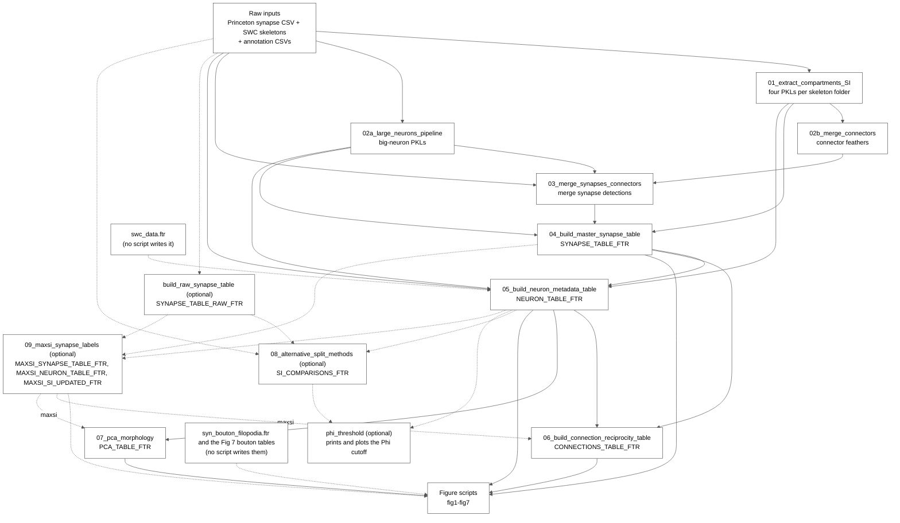

# Pipeline Overview

This document describes the processing pipeline that converts raw connectome inputs into the
derived tables used by the figure scripts.

**Run order:** 01 → 02a → 02b → 03 → 04 → 05 → 06 → 07 (08 is optional: the split-method comparison, run after `build_raw_synapse_table.py`, which builds its raw synapse table from the Codex CSV; `phi_threshold.py` is optional and runs after 08; 09 is optional: the MaxSI labels, run after 05 and `build_raw_synapse_table.py`). The larval step, `processing/larva/larva_process.py`, is separate and is needed only for Figure 2A.  
**All paths are defined in:** `config.py`. With `PIPELINE_RUN = "rebuild"` every step reads and writes the `data/derived_rebuild/` and `data/intermediate_rebuild/` copies instead, for a fresh run that leaves the published tables untouched; `swc_data.ftr` and the raw synapse tables are read from `data/derived/` either way  
**The numbered scripts import:** `methods/methods_all.py` via `METHODS_DIR`; 08 and 09 also import `methods/node_cut_si.py`

---

## Pipeline flow

---

## Script 01 — Extract Compartments + SI (standard neurons)

**File:** `processing/01_extract_compartments_SI.py`

Walks each neuron's SWC skeleton to classify synapses as axonal or dendritic, and computes the
Segregation Index (SI) for every standard neuron. Works through the skeleton subfolders of `SWC_DIR` one at a time and saves four pickles per subfolder (`connectors.pkl`, `all_SI.pkl`, `issues.pkl`, `linker.pkl`), each covering every neuron in it. Synapses from a neuron to itself are dropped first, and synapses more than 10,000 nm from the nearest skeleton node are dropped when they are attached, so SI is computed on the axon and dendrite synapses that are left (linker synapses are not counted). A subfolder counts as done once its `linker.pkl`, the last pickle written, exists, so a run that was stopped picks up where it left off and redoes a half-written subfolder. The synapse CSV is read in chunks, keeping only the columns the step uses; reading the full table peaked at a memory footprint of about 10 GB (measured once, macOS).

| | |
|--|--|
| **Inputs** | `PRINCETON_SYNAPSE_CSV`, `SWC_DIR` |
| **Outputs** | Four PKL files per skeleton subfolder in `PROCESSED_SWC_DIR` (`data/intermediate/processed_swc_data/`) |
| **Runtime** | Several hours (a serial loop over the skeleton subfolders): 10.8 hours for all 93 subfolders on a 36 GB Mac, with resident memory up to 22.4 GB, sampled once a minute (one run, macOS) |
| **Downstream** | Scripts 02b, 04, 05 |

---

## Script 02a — Large Neurons Pipeline

**File:** `processing/02a_large_neurons_pipeline.py`

Applies the same compartment-labelling and SI logic as script 01, but for oversized neurons that
require a separate memory/chunking strategy. Also writes big-neuron connector feather tables directly.
It reads the synapse CSV in chunks and keeps only the synapses of its 186 cells; the read peaked at a
memory footprint of about 10 GB (measured once, macOS). Processing each of the four largest cells (two
CT1, two APL; loading, healing, attaching synapses and splitting) took 3.1 to 4.2 minutes, with resident
memory up to 28.0 GB (one run, macOS).

| | |
|--|--|
| **Inputs** | `PRINCETON_SYNAPSE_CSV`, `SWC_DIR` |
| **Outputs** | PKL files in `PROCESSED_BIG_NEURONS_DIR`; `PRE_CONNECTORS_BIGN_FTR`, `POST_CONNECTORS_BIGN_FTR` |
| **Downstream** | Scripts 03, 04, 05 |

---

## Script 02b — Merge Connectors

**File:** `processing/02b_merge_connectors.py`

Reads the `connectors.pkl` file of each script 01 output folder and aggregates them into combined
pre- and post-synaptic connector feather tables for standard neurons. It takes nothing from 02a.
It works through the folders one at a time in folder-name order, appending each folder's rows to the two files,
so step 01's connectors are never all in memory at once (gathering them first would take far more than 32 GB:
step 01 stores every column as Python objects). The rows now come in folder-name order; the earlier version,
which gathered every folder first, took them in an order that changed from run to run. On 15 folders (two sets) it
writes the same tables as that version, sorted by synapse_id. Both files are written under a temporary name and
renamed at the end, so a run that stops part-way leaves the earlier files as they were.

| | |
|--|--|
| **Inputs** | `PROCESSED_SWC_DIR` (the `connectors.pkl` files from script 01) |
| **Outputs** | `PRE_CONNECTORS_FTR`, `POST_CONNECTORS_FTR` (in `data/intermediate/connectors/`) |
| **Downstream** | Script 03 |

---

## Script 03 — Merge Synapses and Connectors

**File:** `processing/03_merge_synapses_connectors.py`

Joins the raw Princeton synapse detection table with the per-neuron connector tables (both standard
and large-neuron batches) to produce a unified synapse table with connector associations.
It reads the synapse CSV in chunks, treated as in step 02a, and keeps every synapse except those from a neuron to
itself. Each chunk gets its pre label from the connector tables, a lookup on `synapse_id` (which appears once in
them, so this is the earlier left join), and is written to `SYNAPSES_PRE_MERGE_FTR`; that file is then read back
piece by piece to add the post label. Only the label and `synapse_id` columns of step 02b's tables are read. Both
files are written under a temporary name and renamed at the end. On the first 2,000,000 rows of the CSV it writes
the same tables, in the same order, as the earlier version, which read the whole CSV at once (the same read peaked
at about 35 GB in step 02a's test) and then the whole connector tables.

| | |
|--|--|
| **Inputs** | `PRINCETON_SYNAPSE_CSV`, `PRE_CONNECTORS_FTR`, `POST_CONNECTORS_FTR`, `PRE_CONNECTORS_BIGN_FTR`, `POST_CONNECTORS_BIGN_FTR` |
| **Outputs** | `SYNAPSES_PRE_MERGE_FTR`, `SYNAPSE_NON_PROCESSED_FTR` |
| **Downstream** | Script 04 |

---

## Script 04 — Build Master Synapse Table

**File:** `processing/04_build_master_synapse_table.py`

Assigns final compartment labels (AA/AD/DA/DD, or one of five linker combinations such as AL) to every synapse in the merged table. This produces
the primary analysis-ready synapse table used by nearly all figure scripts.
It reads step 03's table piece by piece. Each piece loses the synapses missing either label, gets each end's SI by a
lookup on the cell ID (each cell has one SI, so this is the earlier left merge), loses every row with an empty value,
and gets `comp`; the pieces are written in order, under a temporary name renamed at the end. The null and duplicate
counts it prints are computed over the whole table from only the columns they need. On step 03's output for the first
2,000,000 rows of the CSV it writes the same table, and prints the same counts, as the earlier version, which held the
whole table and several copies of it in memory at once.

| | |
|--|--|
| **Inputs** | `SYNAPSE_NON_PROCESSED_FTR`, the SI PKL files from `PROCESSED_SWC_DIR` (per folder) and `PROCESSED_BIG_NEURONS_DIR` (per neuron) |
| **Outputs** | `SYNAPSE_TABLE_SFC_FTR` (`synapses_783_article_princeton.ftr`), under either `SPLIT_METHOD`; `SYNAPSE_TABLE_FTR` is the same file under `"sfc"` |
| **Key columns added** | `comp` (nine possible values; filter to AA/AD/DA/DD), `SI_pre`, `SI_post` |
| **Downstream** | Scripts 05, 06, 09; most figure scripts |

---

## Script 05 — Build Neuron Metadata Table

**File:** `processing/05_build_neuron_metadata_table.py`

Aggregates per-synapse information to the per-neuron level and joins annotation tables to create
the main neuron metadata table used by almost all figure scripts.
It reads only the `pre`, `post` and `comp` columns of the synapse table, the only ones it uses.

| | |
|--|--|
| **Inputs** | `NEURON_ANNOTATIONS_CSV`, `CELL_STATS_CSV`, `NEURONS_CSV`, `SYNAPSE_TABLE_SFC_FTR`, the SI and linker PKLs from `PROCESSED_SWC_DIR` (per folder) and `PROCESSED_BIG_NEURONS_DIR` (per neuron), `RANKS_DIR`, `SWC_DATA_FTR` (not generated by any script; see `docs/data_availability.md`) |
| **Outputs** | `SI_UPDATED_SFC_FTR`, `NEURON_TABLE_SFC_FTR` (`neuron_data_full_article_princeton.ftr`), under either `SPLIT_METHOD` (`SI_UPDATED_FTR` and `NEURON_TABLE_FTR` are the same files under `"sfc"`). The table is built in passes on a working copy, `NEURON_TABLE_PARTIAL_FTR`, and written once at the end, when the copy is deleted |
| **Key columns** | `root_id`, `super_class`, `primary_type`, `nt_type`, `SI`, `cable_length`, synapse counts, morphological features, sensory rank columns |
| **Downstream** | Scripts 06, 07, 08, 09, `phi_threshold.py`; virtually all figure scripts |
| **Note** | The left merge at line 261 keeps every synapse-table cell; those that are not among the annotated cells with an SI get an empty `root_id`, which makes that column float64, and at the size of these IDs a float64 rounds them (it holds only every 128th integer there). Line 298 drops those rows and line 299 sets `root_id` from `neuron`, so the table stores exact int64 IDs, as the delivered table does. Without line 299 the column would hold the rounded float values (no other column would differ); a neuron table written without that line has rounded `root_id` values and should be rebuilt. `tools/check_step05_root_id.py` runs these lines on the real IDs and checks the result. |

---

## Script 06 — Build Connection and Reciprocity Table

**File:** `processing/06_build_connection_reciprocity_table.py`

Takes the synapse table and neuron table, computes per-connection synapse-type counts, identifies
reciprocal pairs, and produces the connection-level analysis table.
It counts the synapse table with pyarrow (only `pre`, `post` and `comp`, only AA/AD/DA/DD), pivots the counts once
into the per-pair table, and finds the reciprocal pairs with a join of each connection with its reverse. On two
slices of the data it writes the same five tables as the earlier version, which used pandas `groupby` and
`pivot_table` twice and a `networkx` graph and, measured on the slices, would have needed far more memory than a
36 GB Mac has; on the full table it took about half a minute and peaked at about 21 GB.

| | |
|--|--|
| **Inputs** | `NEURON_TABLE_FTR`, `SYNAPSE_TABLE_FTR` |
| **Outputs** | `CONNECTIONS_TABLE_FTR` (`connections_by_syn_type_reciprocal_types_filtered_article_princeton.ftr`), `FULL_RECI_CONNECTIONS_FTR` (reciprocal pairs, read by four Fig 5 scripts), `RECIPROCITY_LIST_FTR`, and two intermediate tables, `CONNECTIONS_FILTERED_FTR` and `CONNECTIONS_RECI_FILTERED_FTR` |
| **Key columns** | `pre`, `post`, `AA`, `AD`, `DA`, `DD` (synapse counts), `sum_syn`, `reciprocal` (int 0/1), `primary_type_x`, `primary_type_y`, `same_type` (int 0/1) |
| **Downstream** | Figures 3, 4, 5 |

---

## Script 07 — PCA of Morphological Features

**File:** `processing/07_pca_morphology.py`

Runs PCA on per-neuron morphological feature vectors from the neuron metadata table. Produces
per-neuron PCA scores used in Figure 4 and one supporting script.

| | |
|--|--|
| **Inputs** | `NEURON_TABLE_FTR` |
| **Outputs** | `PCA_TABLE_FTR` (`neurons_pca_princeton.ftr`) |
| **Key columns** | `neuron`, `PC1`, `PC2` |
| **Downstream** | `figures/fig4/build_pc1_table.py`, `figures/fig4/syntype_x_pc1.py`, `figures/fig4/syntype_x_pc1_simple_model.py`, `figures/fig4/ad_chains_x_pc1.py`, `figures/supporting/pc1_x_nt_sclass_pies.py` |

---

## Larval step (for Figure 2A)

**File:** `processing/larva/larva_process.py`

Attaches the larval synapses to the larval skeletons, splits each neuron into axon and dendrite and
computes SI, for the larval curve in Figure 2A. Independent of scripts 01–09.

| | |
|--|--|
| **Inputs** | `LARVA_SWC_DIR`, `LARVA_SYNAPSE_TABLE_CSV`, `LARVA_NEURON_LIST_CSV` (the larval raw files, from the corresponding authors) |
| **Outputs** | `LARVA_SI_FTR`, `LARVA_SYNAPSES_FTR`, and intermediate connector tables in `LARVA_DATA_DIR` |
| **Downstream** | `figures/fig2/fig2a_si_cdf_adult_larva.py` |
| **Note** | As committed it produces no usable output: it calls `attach_synapses_larva2` (line 101), which is not defined in this repository; the bare `except` in `heal_attach`, which is called once on the whole neuron list (line 147), turns that error into a text string, so no neuron is split and the SI output is empty |

---

## Script 08 — Alternative Split Methods (optional)

**File:** `processing/08_alternative_split_methods.py`

Compares the published SFC axon/dendrite split with two single-node cuts: the node whose cut
gives the highest SI (MaxSI), and the node with the lowest Fisher p-value (MinFisherP). A
candidate node is any non-root node with exactly one child; the synapses on that node are left
out of its score. The functions that score the candidate nodes are in `methods/node_cut_si.py`, shared with step 09. Runs over the intrinsic neurons in batches of 500 and skips batches whose
output files already exist. An existing `SI_comparisons.ftr` is never overwritten. `MaxSI_SI` can be lower than
`SFC_SI` (2,433 of 118,347 neurons in the authors' `SI_comparisons.ftr`): the SFC score leaves linker synapses out, while a
single cut places every synapse except those on the cut node on one side, and only nodes with one child can be cut.

| | |
|--|--|
| **Inputs** | `NEURON_TABLE_SFC_FTR` (the SFC cells under either `SPLIT_METHOD`, so the output does not depend on it), `SYNAPSE_TABLE_RAW_FTR`, skeletons in `SWC_DIR` |
| **Outputs** | Per batch in `ALT_SPLIT_BATCH_DIR`: `summary_batch_NNNN.ftr`, `nodes_batch_NNNN.ftr`, `failures_batch_NNNN.ftr`, and `batch_run.json`, a record of what the batches were made from (a rerun that differs, batch files with no record, a missing batch, or summaries and failures that together do not cover every neuron of the run stop the script; a neuron whose split has not one axon and one dendrite is a failure); combined `SI_COMPARISONS_FTR` (`SI_comparisons.ftr`), written only if that file does not already exist |
| **Key columns** | `neuron_id`, `SFC_SI`, `SFC_Phi`, `MaxSI_SI`, `MinFisherP_Phi` |
| **Downstream** | `processing/phi_threshold.py` |
| **Note** | `SYNAPSE_TABLE_RAW_FTR` is built by `processing/build_raw_synapse_table.py`; `SWC_DIR` must hold the skeletons of every intrinsic neuron, so the script cannot be run from the downloads alone. Unlike scripts 01 and 02a, it does not drop synapses from a neuron to itself, so its `SFC_SI` matches the SI that script 05 writes (`SI_updated.ftr`) only if the raw table has none: the default version (`RAW_TABLE_KEEP_SELF_SYNAPSES = False`) has none. When combining, a missing batch file stops the combine step. To run it on some neurons only, for example those whose skeletons you have, use `tools/check_split_methods_on_subset.py` (README, Tools); `tools/check_split_functions.py` checks step 08's split code on made-up neurons, and `tools/compare_split_runs.py` compares the cuts of two runs |

---

## Script 09 — MaxSI Synapse Labels (optional)

**File:** `processing/09_maxsi_synapse_labels.py`

Labels every synapse end A or D under the MaxSI split, so that the figure scripts can read the
MaxSI split in place of the published SFC split. The MaxSI tables inherit the SFC tables' cells and
synapse rows: a cell the SFC split failed on is never tried. For every cell of `NEURON_TABLE_SFC_FTR`
(every super-class), it heals the skeleton (`navis.heal_skeleton`) and attaches the synapses (`attach_synapses_princeton`, which keeps `synapse_id`). These are the two calls inside `methods_all.heal_attach_princeton`; step 09 makes them itself, so a failed cell records the real error message. It scores every candidate cut with
step 08's own code (`methods/node_cut_si.py`) and cuts at the node with the highest SI; on a tie
it takes the first node in the node table's order (pandas `idxmax`), and the summary records how many
nodes tie, how many different side counts they give, and how many are within numpy isclose of the highest SI. Side 1 is the cut node's
child and its descendants, side 2 the rest of the cell without the cut node. The axon is the side
whose presynaptic fraction is above the whole cell's, counted without the cut node's synapses;
a cell whose two sides have the same fraction, or with a side that has no synapse, fails and gets
no labels. The synapses on the cut node get no label. The raw synapse table must have no
self-synapses (the script stops otherwise). Batches of 500, skipped when their files exist;
each batch file is written under a temporary name and renamed, the failures file last.
`batch_run.json` records the cell list, the raw synapse table, the skeleton files (count and a hash of
their paths and sizes) and the navis version, and a run with different ones is refused. It stops at the start if
a skeleton file name is in two subfolders of `SWC_DIR`, and stops on a `MemoryError` instead of
recording it as a failed cell. Before writing a table it prints the failure count and errors, then stops if: a cell failed for want of a
usable skeleton (unless `ACCEPT_CELLS_WITHOUT_SKELETON = True`); the number of failed cells is not
`ACCEPT_FAILED_CELLS` (None: no cell may fail); no cell was labelled; the batches do not hold every cell
exactly once; or only some of its three tables exist.

| | |
|--|--|
| **Inputs** | `NEURON_TABLE_SFC_FTR`, `SYNAPSE_TABLE_SFC_FTR`, `SYNAPSE_TABLE_RAW_FTR` (without self-synapses; the script stops otherwise), the skeletons of every cell of the neuron table in `SWC_DIR` |
| **Outputs** | Per batch in `MAXSI_LABEL_BATCH_DIR`: `labels_batch_NNNN.ftr` (`synapse_id`, `neuron`, `side`, `label`), `summary_batch_NNNN.ftr` (one row per cell: `best_node_id`, `MaxSI_SI`, `n_tied_max_SI`, `n_tied_max_SI_distinct_sides`, `n_close_max_SI`, side counts, `axon_side`), `failures_batch_NNNN.ftr`, `batch_run.json`. Combined: `MAXSI_SYNAPSE_TABLE_FTR` (the SFC synapse table's columns and dtypes; `comp` from the MaxSI labels, `SI_pre`/`SI_post` = `MaxSI_SI`; rows with an unlabelled end are left out and counted in the log), `MAXSI_NEURON_TABLE_FTR` (the SFC neuron table's columns, and its rows less the cells that failed, which are dropped and counted in the log as step 05 drops cells with no SI; `SI` = `MaxSI_SI`; `pre_A` to `post_L`, `axon_correct`, `dend_correct` counted from the MaxSI synapse table with step 05's code; `linker` = 0; every other column is copied from the SFC table, including the synapse, degree and partner counts and the ratio columns that step 07 and the figures use as cell features) and `MAXSI_SI_UPDATED_FTR` (`root_id`, `SI` = `MaxSI_SI`, in the format of `SI_updated.ftr`). The log also counts labelled ends that have no row in the SFC synapse table, ends lost to the cut node and to an unlabelled partner, and kept cells whose `axon_correct` or `dend_correct` is empty here but not in the SFC table. The three tables are written together, and none is overwritten if they exist |
| **Downstream** | With `SPLIT_METHOD = "maxsi"` in `config.py`, every script that reads `SYNAPSE_TABLE_FTR`, `NEURON_TABLE_FTR` or `SI_UPDATED_FTR` reads these three tables instead. See README, Reproducing the analysis, for what else moves, what stops and the run order |
| **Note** | `ONLY_LOCAL_SKELETONS = True` or a `LIMIT` runs only the cells whose skeleton is under `SWC_DIR` and writes everything to `MAXSI_SUBSET_DIR`, for checking; the synapse table holds only the rows whose two ends are both chosen cells, so the neuron table's `pre_A` to `post_L` are not the full cells' counts. `tools/check_step09_failures.py` runs step 09 on five local cells with planted failures. The MaxSI labels have no `L`, so `pre_L` and `post_L` are 0. Cost and memory: see README |

---

## Raw synapse table (optional)

**File:** `processing/build_raw_synapse_table.py`

Builds the synapse table before any filtering from the Codex CSV: row number as `synapse_id`, the
`ctr_*` columns dropped, full root ids rebuilt, and the columns renamed by position (the script first
checks the CSV's column order). `BUILD` at the top chooses which versions to write.

| | |
|--|--|
| **Inputs** | `PRINCETON_SYNAPSE_CSV` |
| **Outputs** | `SYNAPSE_TABLE_RAW_NO_SELF_FTR` (76,944,712 rows) and `SYNAPSE_TABLE_RAW_WITH_SELF_FTR` (80,215,790 rows) |
| **Downstream** | `SYNAPSE_TABLE_RAW_FTR` (one of the two, by `RAW_TABLE_KEEP_SELF_SYNAPSES`): step 08, step 09 (only the version without self-synapses), `figures/fig1/create_split_axon_dendrite_princeton.py`, `figures/split_methods/skeleton_comparisons*.py` |
| **Note** | Peaked at about 40 GB of memory (22 GB resident) and took 2 minutes on a 36 GB Mac; both versions together take about 7 GB on disk. Check the result with `tools/check_raw_synapse_table.py` |

---

## Phi threshold (optional)

**File:** `processing/phi_threshold.py`

Finds the Phi value that matches the SI = 0.1 cutoff, so that split methods scored with Phi
can use a matching cutoff. It uses the SFC split, where `SI_comparisons.ftr` gives each neuron
both an SI and a Phi, and keeps only the intrinsic neurons (the four super-classes the figures
use). It finds the cutoff in three ways: the typical Phi of neurons with SI within 0.005 of 0.1,
the Phi value that calls the same share of neurons mixed, and the Phi cutoff that agrees with
SI < 0.1 for the most neurons. The recommended cutoff is the median of the three, rounded to two
decimals, and is reported with the range of the three. The script also prints the share of
neurons each method calls mixed, checks the match within super-classes and by input/output
balance and synapse count, and gives 95% intervals by resampling whole cell types. Phi does not
follow SI exactly, so the match holds on average, not for every neuron.

| | |
|--|--|
| **Inputs** | `SI_COMPARISONS_FTR`, `SI_UPDATED_SFC_FTR` (the script stops unless `SFC_SI` equals it, so the cutoff matches the SI in this file), `NEURON_TABLE_SFC_FTR` (super_class, primary_type, and axon/dendrite input and output counts for grouping) |
| **Outputs** | Printed results, and `outputs/processing/phi_threshold/phi_threshold.svg` (under `outputs_maxsi/` when `SPLIT_METHOD = "maxsi"`; the typical Phi at each SI, and the Phi of the neurons at SI = 0.1, with the three estimates) |
| **Downstream** | None in this repository |

---
