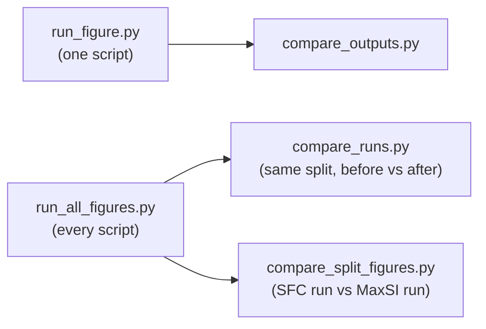

# Tools

The scripts in `tools/` check the pipeline and the figure scripts, and compare runs. Run them from the repository
root with the environment active. Each one has `--help`, and its docstring has the full details; this page says what
each tool is for, what it needs and what its result means.

Most check tools print PASS or FAIL and exit with status 1 on a failure. Three exceptions: `compare_split_figures.py`
exits 0 whatever it finds (only its selftests can fail), `check_split_methods_on_subset.py` checks nothing without
`--compare`, and `compare_split_runs.py` exits 1 on a difference only with `--expect-identical`. A PASS holds only for the data the tool
was given. None of the tools shows that an analysis is the right one.

## Which tool do I need?

| I want to... | Tool |
|---|---|
| check that one figure still comes out the same after a change | `run_figure.py`, then `compare_outputs.py` |
| check every figure at once | `run_all_figures.py`, then `compare_runs.py` |
| see which drawn numbers change between two splits (SFC and MaxSI) | `compare_split_figures.py` |
| check the raw synapse tables, or step 05's `root_id` | `check_raw_synapse_table.py`, `check_step05_root_id.py` |
| check the Figure 6 or revised 4E script without their input tables | `check_fig6_logic.py`, `check_fig4e_logic.py` |
| keep the Fig 7 scripts tied to the authors' originals | `make_fig7_ports.py`, `check_fig7_ports.py`, `check_fig7_tables.py` |
| count synapse types, or compare them between splits | `synapse_type_shares.py`, `split_agreement.py` |
| check the split methods (step 08) or step 09 | `check_split_methods_on_subset.py`, `check_split_functions.py`, `check_step09_failures.py`, `compare_split_runs.py` |
| check the Fig 4 simple PC1 model | `check_simple_pc1_model.py` |
| check that every figure's text is Arial 8 pt | `check_figure_text.py` |

## Checking that a figure reproduces

The usual loop: run, change, run again, compare.



### `run_figure.py`: run one figure script so two runs can be compared

It runs the script with no plot windows, fixed random numbers (seaborn's error bands too), SVGs without a date, and a
checksum after every printed table, so a change in a hidden row still shows up. `run_status.txt` says whether the
script finished.

| Setting | |
|---|---|
| Output | `--out`, a new or empty folder (default `outputs/tools/run_figure/<script name>/`) |
| `--dpi` | 72 by default, the same as the published SVGs |
| `--replace OLD NEW` | swaps an exact piece of the script's text before it runs, for example to skip a slow step; the run is then no longer a full reproduction |

All figures go into one folder, so two figures saved under the same name in different subfolders overwrite each
other. Tables the script writes still go to their usual place and replace what is there.

### `compare_outputs.py`: compare two `run_figure.py` folders

Files are matched by name. An SVG passes if it is identical, or identical once ids and metadata are ignored; any other
file must be identical. `stdout.log` must match too; `stderr.log` is never compared. It exits with status 1 if
anything differs, a run didn't finish, or neither folder has a figure.

| Option | What it does |
|---|---|
| `--allow-extra-lines` | the second run may print extra lines, as long as every line of the first appears in order |
| `--figures-only` | compares .svg, .png and .pdf only (useful against a folder of published SVGs) |
| `--allow-no-figures` | for a script that only prints or writes tables, such as `figures/fig4/build_pc1_table.py` |
| `--content` | an SVG that still differs passes if it draws the same text, colours, markers and shapes once the plot's size and position are removed (to 0.1% of the plot). Use it for a port saved at another figure size or font. Line widths and font sizes are not compared, and text saved as outlines fails |

```bash
python tools/run_figure.py figures/fig1/canonicality_axon_dend.py --out outputs/tools/run_figure/before
# make your change, then run again into a new folder
python tools/run_figure.py figures/fig1/canonicality_axon_dend.py --out outputs/tools/run_figure/after
python tools/compare_outputs.py outputs/tools/run_figure/before outputs/tools/run_figure/after
```

### `run_all_figures.py`: run every figure script

It runs each script under `figures/` through `run_figure.py`, each into its own subfolder of `--out`. Scripts that
others read run first: `build_pc1_table.py`, `fig4_heldout_models.py`, `reciprocal_fraction.py`, the three Fig 7
`si_sim_*.py` and `fig7i_filopodia_fraction_x_nt.py`. A full run takes several hours.

| Setting | |
|---|---|
| Time limit | 20 minutes per script, 3 hours for the few slow ones listed in the script (`--timeout`, `--long-timeout`, in seconds); a script out of time is stopped with its worker processes |
| Records | `progress.txt` (one line per script), `commit.txt` (git commit, whether there were uncommitted changes, `SPLIT_METHOD` and `PIPELINE_RUN`), `inputs.txt` (size and date of every file in the input folders, to trace a difference to changed data) |
| Resume | run again with the same `--out`: scripts that finished or stopped with an error are skipped, timed-out or interrupted ones run again, and `--rerun-failed` also reruns those that stopped with an error |
| `--only fig4` | runs a subset |

It exits with status 1 if any script did not finish, which here includes every script whose input tables are not
supplied. Scripts that write tables still replace them (for example the 3 GB `data/derived/PC1_table.csv`).

### `compare_runs.py`: compare two full runs, script by script

It compares the run status, every saved figure (as `compare_outputs.py` does) and the printed output. `--mask` blanks
text that changes on every run, such as dates in statsmodels summaries; `--report FILE` also writes the result to a
file. It exits with status 1 if any script differs or is in only one run.

```bash
python tools/run_all_figures.py --out outputs/tools/run_all_figures/before
# make your change, then run again into a new folder
python tools/run_all_figures.py --out outputs/tools/run_all_figures/after
python tools/compare_runs.py outputs/tools/run_all_figures/before outputs/tools/run_all_figures/after \
    --mask "[A-Z][a-z]{2}, \d{2} [A-Z][a-z]{2} \d{4}" --mask "\d{2}:\d{2}:\d{2}"
```

### `compare_split_figures.py`: which drawn numbers change between two splits

For two full runs on different splits (for example `SPLIT_METHOD = "sfc"` and `"maxsi"`), it reads the numbers back
from each SVG's text and compares them panel by panel.

How it reads a figure:

| Kind | What counts |
|---|---|
| n | a number after `n=` or `n =` (either case) |
| data | a number with decimals, a % sign or a k/K/M suffix ("4.65M" is read as 4,650,000) |
| integer | any other whole number |
| tick | any number in an axis tick, kept apart from the rest |
| text | every label with no number (cell-type names, category ticks, legend entries), in order |

Numbers are paired by their position in the file. A number counts as changed if its value changes or it gains or
loses a % sign. A pair is marked when the label next to it differs, because position pairing may then have matched
different things. It also compares each script's `stdout.log` line by line once the numbers are masked, listing up
to `--max-lines` (25) changed lines, and names each figure's panel from `docs/figure_to_script_map.md` where it can.

Each SVG gets one verdict:

| Verdict | Meaning |
|---|---|
| byte-identical | the files are the same |
| counts differ | one side draws more numbers than the other |
| numbers changed | at least one drawn number changed |
| numbers identical; ... | the numbers are the same, but the labels, text or ticks listed after it changed |
| no drawn numbers besides ticks; ... | only ticks and text to compare; says what changed, or "nothing else changed" |
| could not be read | the SVG did not parse |

PDF and PNG files are only listed ("byte-identical" or "listed only (bytes differ)"); a file in one run only is "only in"
that run.

The report header gives every line of each run's `commit.txt`. It warns if the two runs were made on different commits,
and names the files under `figures/`, `processing/`, `methods/` and `config.py` that differ between them. Changed
scripts under `figures/` are marked next to their results. A changed file outside `figures/` can affect any script, so
none is marked for it. It also warns if a run had uncommitted changes: `commit.txt` notes that there were some, not
what they were.

Output: `report.txt` and `cells.csv` (one row per number) in `outputs/tools/compare_split_figures/<label_a>_vs_<label_b>/`
(or `--out`). It takes under a second.

What it cannot see: a curve, bar or point with no label; a number glued to another unit ("12ms"); a number with no
leading zero (".05").

`--selftest` runs it on two small made-up runs with known differences. `--mutants` plants 31 known bugs, one at a time,
and requires the selftest to fail on each.

```bash
python tools/compare_split_figures.py outputs/tools/run_all_figures/sfc outputs/tools/run_all_figures/maxsi --labels SFC MaxSI
python tools/compare_split_figures.py --selftest
python tools/compare_split_figures.py --mutants
```

## Checking the data tables

| Tool | What it checks | Needs | Time |
|---|---|---|---|
| `check_raw_synapse_table.py` | the raw synapse tables `processing/build_raw_synapse_table.py` writes: columns and types, `synapse_id` in order and unique, the version without self-synapses differing from the other by exactly those, every processed synapse present with the same pre and post cell, and the six coordinates (which catches a pre/post swap). `--csv` also checks the row count against the Codex CSV | step 04's synapse table, about 10 GB of memory (`--csv` also reads the Codex CSV) | 1 to 2 minutes |
| `check_step05_root_id.py` | that step 05 writes `root_id` as exact cell IDs: it runs step 05's own lines on the real IDs and checks `root_id` is int64 and equal to `neuron`, nothing else changes, and the cells kept are the neuron table's. `--script` tests another copy | step 05's outputs, the annotation file and the synapse table's pre and post columns, about 5 GB of memory | a few seconds |

`check_step05_root_id.py` writes `outputs/tools/check_step05_root_id/report.txt`.

## Checking scripts on made-up data

Two figure scripts read tables that are not deposited. These tools run each script's own code on a small made-up
input and compare every result with values worked out by hand. A PASS means the script computes what its code says,
not that the figure is the right analysis. Both take a few seconds, write `outputs/tools/<tool name>/report.txt` with
the script's checksum, and take `--script FILE` to check another copy.

| Tool | Script | Made-up input | What it checks |
|---|---|---|---|
| `check_fig6_logic.py` | `figures/fig6/aadd_specific_circuits.py` (Fig 6, needs the Buhmann tables) | 23 cells, 156 synapses between 27 pairs | which connections count (SI threshold, including a value exactly at it, type filters, populations), the within-type and reciprocal fractions, bar order, printed summaries, the summary table, the between-type edges, the SVG files, the other data sources, and that a wrong `DATA_SOURCE` or a missing table stops the script. Not tested: the rest of the drawing and the interactive cells at the end |
| `check_fig4e_logic.py` | `figures/fig4/syntype_x_pathway_layers.py` (revised Fig 4E) | 27 rows of the per-type table, a `neuron_data` table | every table it writes, the four line plots and two stacked-bar plots, neuropil names (left/right dropped, `LAL` not read as `LA`), shares of AD, AA, DD and DA only, the olfactory types and pairs, `NA` and `None` read as type names, the script's own rebuild of its input from the Princeton or Buhmann tables (`DATA_SOURCE`, `SI_SOURCE`), and that a wrong `DATA_SOURCE` or a missing table stops it |

## Figure 7 ports

The seven `figures/fig7/fig7*.py` scripts are made from the authors' original Figure 7 scripts, which are not in this
repository (give their folder with `--originals` or `FIG7_ORIGINALS`). These are maintainers' checks: on a clean clone
they stop, or report the tables missing.

| Tool | What it does |
|---|---|
| `make_fig7_ports.py` | makes the seven scripts from the originals. By default it checks that each script is exactly what it makes, so a hand edit fails (a change belongs in its list of fixes); `--write` rewrites them, only from originals whose checksums it knows. `--selftest` plants mistakes in its fix list |
| `check_fig7_ports.py` | runs each original and its port side by side, without writing anything real, and compares what they draw, print, read and write, and that each port saves its SVGs into `outputs/fig7/<script>/` in Arial. Text is set to Arial 8 pt on both sides, so fonts are not compared. A port whose input is missing (7E) is reported as not run. `--mutants` plants 27 bugs; `--only` checks some of the seven; `--timeout` defaults to 1200 s. About a minute, 5 with `--mutants` |
| `check_fig7_tables.py` | checks the Figure 7 tables `config.py` names (and `NEURON_TABLE_FTR`) against `tools/fig7_tables_reference.json`: checksums, columns, types, rows, 64-bit IDs, duplicate keys. `--selftest` requires altered copies to fail; `--record` writes a new reference to `outputs/tools/check_fig7_tables/` for review. About a minute |

A PASS of `check_fig7_ports.py` means a port does what the original does on this machine, not that it reproduces the
published panel.

## Synapse-type tools

Both read the synapse and neuron tables from `data/derived/` (`data/derived_maxsi/` under `SPLIT_METHOD = "maxsi"`).

| | `synapse_type_shares.py` | `split_agreement.py` |
|---|---|---|
| What it gives | the share of AD, AA, DD and DA, for all synapses and for intrinsic neurons, with and without the SI filter; synapses with a linker end are left out of the shares and counted separately | for each pair of splits and four groups of synapses: agreement, chance agreement, Cohen's kappa, per-type agreement and the 4 x 4 table; then agreement by SI band and per neuron |
| Memory | about 4 GB (5 GB with `--si corrected`) | about 12 GB |
| Options | `--si corrected`, `--table`, `--column` | `--si corrected`, `--table`, the columns to compare, `--bootstrap N` (95% intervals for agreement and kappa, by resampling cell types; use 1000 or more for quoted intervals; `--cluster neuron`, `--seed`) |

- **Intrinsic** means super-class `central`, `optic`, `visual_projection` or `visual_centrifugal`, with `axon_correct`,
  `dend_correct` and `primary_type` filled in, as in the figure scripts.
- **The SI filter** keeps synapses with `SI_pre` and `SI_post` both at least 0.1. By default this SI comes from the
  published split, so it picks neurons that split separates well, and agreement with it looks higher on the filtered
  synapses. `--si corrected` uses `SI_updated.ftr` instead, in both tools.
- `split_agreement.py` needs a table with one synapse-type column per split. No table in this repository has more than
  one: step 08 scores splits per neuron, and step 09 writes its MaxSI labels to a separate table.

```bash
python tools/synapse_type_shares.py
python tools/synapse_type_shares.py --si corrected
```

## Checking the split methods

### `check_split_methods_on_subset.py`: run step 08 on some neurons

It runs step 08 on a subset (by default every intrinsic neuron whose skeleton is under `SWC_DIR`), so the split methods
can be checked without the full skeleton download. It needs the raw synapse table. It patches four places in
`processing/08_alternative_split_methods.py` rather than keeping its own copy, and stops if any is not found exactly
once.

| Setting | |
|---|---|
| Output | `--out`, a new or empty folder: the patched copy, `provenance.txt` (commit, checksums, input sizes and dates, pandas and numpy versions), `per_neuron.csv` |
| `per_neuron.csv` | step 08's four scores per neuron, its status, the MinFisherP Phi recomputed as a check, and MaxPhi (a split method step 08 does not have) |
| `--ids FILE`, `--limit N` | choose other neurons |
| `--resume` | continues a stopped run; refuses if the neurons, inputs or the tool changed |
| `--compare REF.ftr` | compares each score per neuron with a reference that has a `neuron_id` column, to `--tol` (default 1e-9); differences go to `differences_*.csv` |
| `--compare-only` | repeats the comparison on a finished run |

Time and memory were measured on macOS, on runs that used navis's own flow centrality. Step 08 uses
`methods/flow_centrality.py`, which skips navis's dense matrix, so these figures may not hold for it. 1,144 intrinsic
neurons took 28 to 36 minutes; reading the synapse table peaks at 12.4 GB, and a run that read the whole table peaked
at 24.7 GB, almost all of it from one batch of 500 neurons. 20 neurons took 13 seconds and about 1 GB. Use `--limit` on a smaller machine.

A PASS covers only the neurons run. Against a table made by the same step 08 code it shows that the result does not
depend on which neurons run together, not that the method is right.

```bash
python tools/check_split_methods_on_subset.py --out outputs/tools/check_split_methods_on_subset/run1 \
    --compare data/derived/SI_comparisons.ftr
python tools/check_split_methods_on_subset.py --out outputs/tools/check_split_methods_on_subset/run1 --compare-only \
    --compare data/derived/SI_comparisons.ftr other_summary.ftr
```

`other_summary.ftr` stands for any table with a `neuron_id` column.

## Checking step 08's split code

### `check_split_functions.py`: step 08's cut choice on made-up neurons

It runs step 08's own batch function on small made-up neurons and compares with a separately written reference: side
counts, SI and Fisher p of every candidate cut, `absolute_phi`, the nodes MaxSI and MinFisherP choose, the axon side
(ties and empty sides too), and that neurons with no valid cut fail. It also runs random trees, a 20,000-node chain and
re-rooted trees, and reports how often a tie decided the choice. Not tested: the SFC split, loading skeletons and
synapses, and the IG, `fisher_q` and odds-ratio columns. About 40 seconds; `--random N` (default 300) and `--seed` set
the random trees, `--script FILE` checks another version.

### `check_step09_failures.py`: step 09 with planted failures

It runs step 09 on five local cells, with two planted failures: a skeleton navis cannot read, and a cell whose synapses
all sit on one leaf. It checks that step 09:

- stops for the missing skeleton and for failed cells not yet accepted, and records both;
- once they are accepted, writes the three tables without them, with `comp`, the SIs and the compartment counts right;
- never overwrites a table, and stops if only some of the three exist;
- refuses batches made from another skeleton set or raw table;
- stops on a skeleton name in two subfolders, a `MemoryError`, no cell labelled, or a cell in two batches;
- handles batches made only of failed cells, and fails a cut whose two sides have the same presynaptic fraction;
- keeps every other neuron-table column equal to the SFC table's, and works in the full run, not only on the subset.

It needs the SFC tables, the raw synapse table and at least five local skeletons, and takes about four minutes.
`--script FILE` checks another copy of step 09.

```bash
python tools/check_split_functions.py
python tools/check_step09_failures.py
```

Both write `outputs/tools/<tool name>/report.txt`.

## Comparing two runs of step 08

`compare_split_runs.py` compares two step 08 runs on the same neurons, for example cuts chosen on two different
synapse tables. It scores run A's chosen cut on run B's synapses and reports, for MaxSI and MinFisherP, how many nodes
and cuts differ, how many neurons cross a cutoff (SI 0.1; |Phi| 0.36), how many MinFisherP differences are ties at
p = 0, and how many synapses switch between axon and dendrite.

| Option | What it does |
|---|---|
| `--exact raw\|processed` | give the synapse table run B used; it rebuilds the differing neurons from the skeletons in `SWC_DIR` and counts the switched synapses exactly (otherwise it gives a range) |
| `--expect-identical` | exits with status 1 unless the neurons, chosen nodes, side counts and SFC SI all agree |
| `--si-cutoff`, `--phi-cutoff` | change the two cutoffs |

Output: `summary.txt` and `per_neuron.csv` in `outputs/tools/compare_split_runs/` (or `--out`).

```bash
python tools/compare_split_runs.py RUN_A/batches RUN_B/batches --exact processed
```

On the 1,144 neurons of skeleton folder 7, choosing the cut on the processed instead of the raw synapse table changed
the MaxSI cut in 34 neurons and the MinFisherP cut in 55, none across its cutoff.

## Checking the simple PC1 model

`check_simple_pc1_model.py` rebuilds the model of `figures/fig4/syntype_x_pc1_simple_model.py` (a random forest that
predicts a synapse's type from PC1 of its two cells) in its own code and prints the counts, test accuracy, confusion
matrix and feature importances.

| Option | What it does |
|---|---|
| `--run DIR` | checks a `run_figure.py` run of the script: the accuracy exactly, the 16 confusion-matrix percentages to 0.005, and the two importances to `--tol-importance` (default 0.001) |
| `--variants` | repeats the rebuild with one change each (another balancing seed, PC1 sign flipped, cells without PC1 left out) to show how much the results move |
| `--earlier DIR` | with `--run`, compares with an earlier run's SVGs, for information |
| `--report FILE` | also writes the output to a file |

It needs about 7 GB; with `--variants` it took about 8 minutes (measured once, macOS). The result is exact only with the pinned
library versions. A PASS means the script computes what its code says on the same tables, not that the model is sound
(rows are resampled before the split, and the split is by synapse).

```bash
python tools/run_figure.py figures/fig4/syntype_x_pc1_simple_model.py --out outputs/tools/run_figure/simple_model
python tools/check_simple_pc1_model.py --run outputs/tools/run_figure/simple_model --variants
```

## Checking the figure text

`check_figure_text.py` checks `methods/figure_text.py`, which every figure script uses so that all its text is Arial
8 pt. It draws made-up figures with every kind of text the scripts use, at sizes from 3 to 20 pt, saves them in every
way the scripts do, and reads each text's font back. It checks that every text is Arial 8 pt, that legends keep
everything else they were asked for, and that nothing else in the figure changes.

| Mode | What it does | Time |
|---|---|---|
| (default) | the check above; writes `outputs/tools/check_figure_text/report.txt` | a few seconds |
| `--mutants` | plants 22 mistakes in a copy of the module and requires each to fail | a few minutes |
| `--outputs DIR` | reads every SVG and PDF of a run and fails on any text that is not Arial 8 pt; writes `outputs_report.txt` | |

With `--outputs`, maths exponents (drawn at 5.6 pt) are listed, not failed, PNG files cannot be read, and in a PDF
symbols such as Greek letters and ≥ are checked by font name only. Figures written with `fig.canvas.print_figure`
instead of `savefig` skip `use_arial_8()`, and without Arial installed the SVG text still names Arial while PNG and
PDF use another font. A PASS means `use_arial_8()` sets every text it is given; whether a panel still looks right at
8 pt has to be seen on the panel.

```bash
python tools/check_figure_text.py
python tools/check_figure_text.py --mutants
python tools/check_figure_text.py --outputs outputs/tools/run_all_figures/<run>
```
